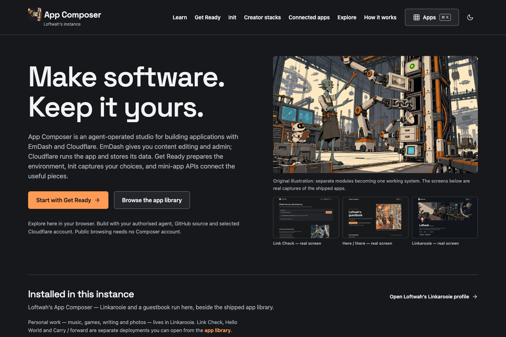

# App Composer

Build a stack of independent apps, configure its instances, then preview and publish a shareable revision. Each app keeps its own source, records, media and release. EmDash provides the creator interface; this installation runs on Cloudflare.

[Open App Composer](https://composer.loftwah.com/) · [Explore the working tools](https://composer.loftwah.com/discover) · [Your app, your admin](https://composer.loftwah.com/manage) · [Follow the tutorial](https://composer.loftwah.com/learn) · [Read the build story](https://composer.loftwah.com/building)

Start with [Launch Kit](https://composer.loftwah.com/launch-kit) to make a profile card or app icons, [watch the team application films](https://composer.loftwah.com/platform/demo), or [inspect recorded analytics](https://composer.loftwah.com/activity). Invited members open [My profile / My apps](https://composer.loftwah.com/me).

Try the published fictional examples: [Trail Notes](https://composer.loftwah.com/s/fictional-trail-notes) and [Launch Board](https://composer.loftwah.com/s/fictional-launch-board). They have independent visitor books; Trail Notes also labels an intentional shared view. They were created through the native editor. These demonstrations establish neither new-user admission nor customer adoption.



Actual production capture, 18 October 2026, source `1bc90251200f9950203220b8d50ee3f4bab54ade`. [Phone view](docs/images/composer-20261018-phone.png) · [Capture provenance](docs/images/capture-20261018.json).

## Run locally

Use Node 22 and the declared pnpm 12.8.1. Install the pinned dependencies, then start the local site:

```sh
pnpm install --frozen-lockfile
pnpm dev
```

Local EmDash data is separate from production. A fresh checkout does not contain the owner's records, credentials or Access session. [The operator reference](docs/operator-reference.md) explains native administration, local setup, reference apps, selected accounts and generated projects.

| Command | Purpose |
| --- | --- |
| `pnpm dev` | Check generated application source and start local Astro |
| `pnpm check:types` | Check strict source, emitted distributions and Astro |
| `pnpm lint` | Check semantic and unused-source rules in the maintained content/Creator programs |
| `pnpm format:check` | Check maintained Creator and enquiry files named by the format gate |
| `pnpm test` | Run the existing behavioural and boundary tests |
| `pnpm check` | Run the current required quality gates |
| `pnpm build` | Build and inspect the public artifact |
| `pnpm source:write` | Explicitly regenerate checked runtime files |
| `pnpm deploy` | Guarded clean pushed-main production release and live verification |
| `pnpm ready` | Inspect the explicitly selected workspace and environment |
| `pnpm init:paperwork` | Reproduce the exact reviewed static PDF editor with a portable configuration |
| `pnpm init:site` | Generate an independent content project |
| `pnpm wordpress:lab` | Operate the isolated fictional WordPress publisher fixture |

[Engineering baseline and checker coverage](docs/engineering-baseline.md) · [Source map and generated-asset maintenance](docs/source-maintenance.md). The content-site recipe deliberately retains its separately exercised pnpm 12.9.1 lockfile. The remaining unchecked legacy source and whole-repository command gaps stay explicit in #175.

## Independent apps

| App | What it does | Source | Standalone |
| --- | --- | --- | --- |
| Paperwork | Browser-local PDF form filling, drawing and visual signatures | [Paperwork](https://github.com/loftwah/app-composer-paperwork) | [Open](https://composer-paperwork.loftwah.workers.dev/) |
| Here / there | Moderated photographs and visitor postcards | [Guestbook](https://github.com/loftwah/app-composer-guestbook) | [Open](https://guestbook.loftwah.com/) |
| Linkarooie | Curated links and eligible source contributions | [Showcase](https://github.com/loftwah/app-composer-showcase) | [Open](https://showcase.loftwah.com/) |
| Link Check | Inspect a destination and explain its findings | [Link Check](https://github.com/loftwah/app-composer-linkcheck) | [Open](https://share.loftwah.com/) |
| Hello World | Small configurable starter for the Get Ready journey | [Hello](https://github.com/loftwah/app-composer-hello) | [Open](https://ready.loftwah.com/) |
| Carry / forward | Fictional portable assistant state | [State](https://github.com/loftwah/app-composer-state) | [Open](https://ai.loftwah.com/) |

Guestbook and Linkarooie also mount at `/guestbook` and `/showcase` through separately pinned Worker services. Guestbook owns provider/upload APIs and source eligibility; Linkarooie consumes those APIs and owns curation. Updating a standalone app does not silently promote its source into Composer. Carry / forward remains fictional-only until its separate security acceptance.

## Find the right guide

- [Documentation index](docs/README.md): current guides, source maps and detailed commands.
- [Product](PRODUCT.md), [architecture](ARCHITECTURE.md), [design](DESIGN.md) and [interface standard](UNSLOP.md).
- [Invited creators: My profile, People and card publication](docs/invited-members.md), with [the shared access contract](docs/invited-member-access.md).
- [Published demo workflow](docs/creator-stacks/demo-stacks.md), [workspace access](docs/workspace-access.md), [private outcomes](docs/private-outcomes.md), [scoped collection](docs/scoped-collection.md), [Guestbook contributions from Linkarooie](docs/guestbook-contributions.md), [private enquiries](docs/private-enquiries.md), [maintenance and approved exports](docs/workspace-maintenance.md) and [WordPress observation ledger](labs/wordpress/weekender/OBSERVATIONS.md).
- [Current delivery status](docs/STATUS.md) and [canonical release evidence](https://github.com/loftwah/app-composer/issues/11). Dated history is linked separately.

Owner administration retains this installation's Cloudflare Access and native EmDash permission boundaries. Specs and exports are data, never credentials or execution authority. Code rollback, configuration rollback and content/media recovery have different coverage. New accounts, permissions, invitations, purchases and public arbitrary builds are separate gates.

App Composer stays the product identity. Loftwah is its first reference creator; personal material belongs only on the appropriate owner surfaces. Artwork provenance and font licences travel with the assets. Real UI captures demonstrate software; generated artwork never substitutes for a screenshot.

[Contributing](CONTRIBUTING.md) · [Code of conduct](CODE_OF_CONDUCT.md) · [Security](SECURITY.md) · [Accessibility](ACCESSIBILITY.md) · [MIT licence](LICENSE)

Launch Kit turns local artwork into icons, PWA assets and social graphics. [Open the tool](https://composer.loftwah.com/launch-kit), [review a package](https://composer.loftwah.com/init/launch-kit), or [read the supported application paths](docs/launch-kit.md). Its fictional static reference is a working local listening timer, separate from native CMS deployment.
