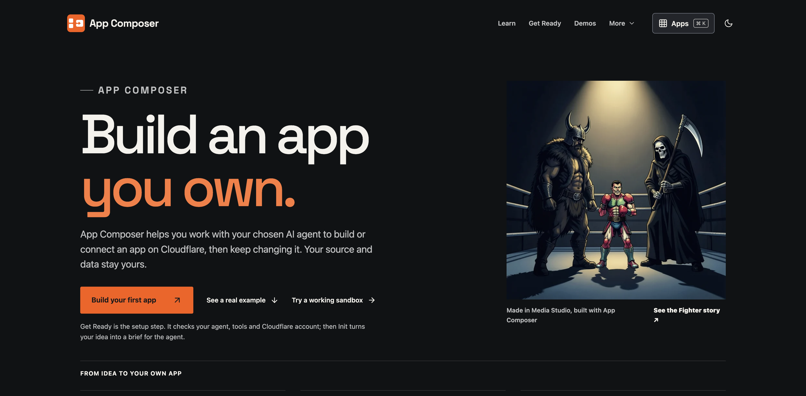
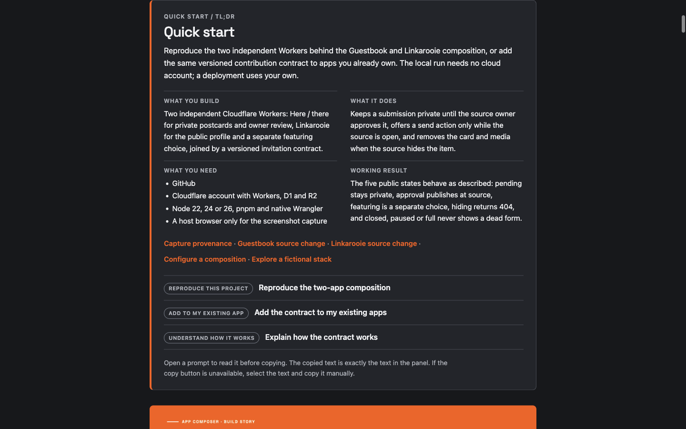
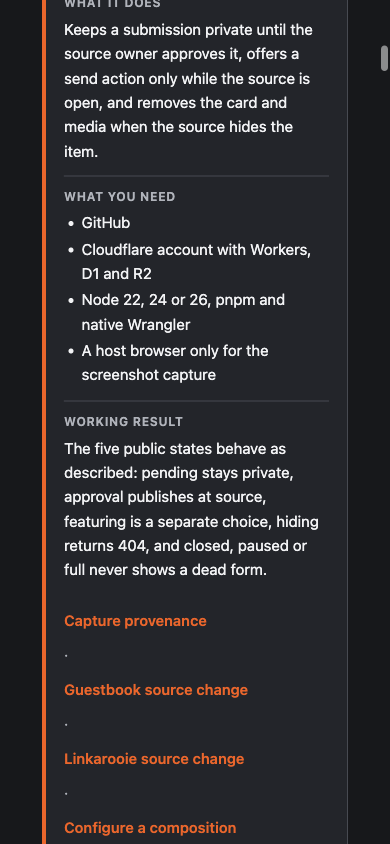
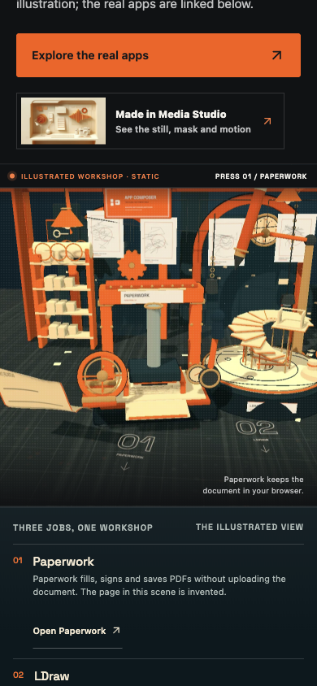
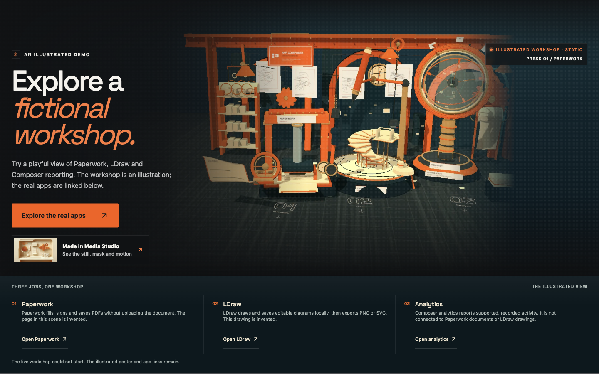
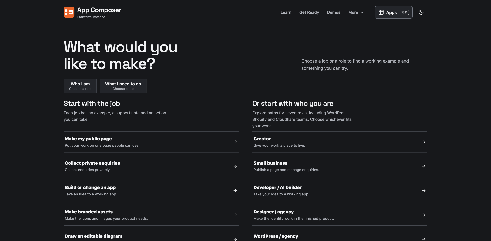

# Product delivery train — 16 November 2026

Owner instruction: run a continuous product-delivery train across App Composer,
Media Studio and the first-party apps in their journeys; implement, integrate,
deploy, verify and close earned issues. This record states the exact sources,
live identities, closures, evidence and remaining gates.

## Release identities

| Surface | Source | Worker | Release time | Live |
| --- | --- | --- | --- | --- |
| App Composer | `01c1446e897ad901118f08d7efb71a7999251be1` | `c29db361-de0a-46b1-ae9d-2b5673358efd` | 87.5s | [build.json](https://composer.loftwah.com/build.json) |
| Media Studio | `eb5e76afe2d0` | `a664896a-3714-44fd-98eb-bfb73c604c19` | 23.2s | [build.json](https://media.loftwah.com/build.json) |

Both used the existing guarded clean-pushed-main paths. No new paid provider
call, real recipient send, public private-media copy, destructive resource
deletion or new infrastructure commitment was made. The owner-held film and
alternate cuts remain private and untouched.

## Closed issues

### Studio #159 — private, version-pinned review rooms

PR #166. Live Studio `9351234c2869`, confirmed again on later releases.

- A reviewer holding two links compares both pinned versions; the second token
  is a same-origin POST field, never in the URL. Both tokens are hash-checked,
  must be open and in the same project, and reject generically. No project/asset
  ID, prompt, caption, lineage, reviewer identity or cross-room feedback is
  returned. Comparisons are rate-limited and not stored.
- The review page now uses a bounded sticky media stage beside the notes on
  wide screens and stacks on phone. A 720×1280 portrait film no longer
  letterboxes into a 916px-wide element or pushes the form below 1070px.
- Real walkthrough on the approved LoftwahFM project: two time-anchored notes
  (0:02–0:04 and 0:12–0:14), changes requested, a new 15s portrait cut saved to
  the same project, compared with the landscape cut, and approved for that
  version only. Cut 1 stayed “changes requested”; cut 2 stayed “awaiting”.
- While open, media returned 206 with `private, no-store`, `no-referrer` and
  `noindex`. After revoking the approved version, its page and media returned
  410 while the other authorised rooms still returned 200/206. All walkthrough
  rooms were then revoked.
- Evidence (private, ignored): `output/train-20261116/walkthrough/`.
- Limits: fictional reviewer; 390px was viewport emulation, not a physical
  phone; the new cut was trimmed locally then imported, not trimmed in Studio’s
  editor; approval remains feedback only.

### Studio #148 — usable Assemble workbench

Live Studio `eb5e76afe2d0`.

- Recorded the real loop on the controlled Withdrawal proof project: saved
  two-scene brief revision 1 → edited Scene 2 → revision 2 → reload → exact
  text persisted → second edit → revision 3 → reload → persisted.
- **Copy script** copied the 33-word combined script. **Open in Studio Voice**
  prepared the narration draft and reported “Narration draft prepared. No
  request was sent.” No paid submit occurred.
- Prior evidence still applies: 113 browser checks, six long scenes, eight
  viewports, 200%/400% reflow, save/reopen, real 409, reduced motion,
  Firefox/WebKit, and no overflow in Library/Create/Assemble/History/Publish/
  Settings at 1440×900 and 390×844.
- Evidence: `output/train-20261116/workbench/` (1440/390 recordings, captures).
- Limits: macOS Chrome automation, not a physical phone or a separate
  hardware-keyboard lab.

## Shipped slices still open

### Composer #489 — shared tutorial quick starts

Seven code-owned tutorials now use one `TutorialQuickStart` component:
`/learn`, `/media-studio`, `/media-studio/tutorial`, `/building`,
`/creator-hub`, `/paperwork`, `/launch-kit`. The visible prompt panel is the
copy source; the tested helper handles success, denied clipboard, no Clipboard
API and empty text, with selected-text and focus fallback.

Live `/building` at 1440: copy produced “Copied. The panel text and the
clipboard text are the same.”; clipboard and panel were both 3,427 characters.
390px had no overflow. 12 focused tests cover the component, inventory,
unsafe links, placeholders, credential-shaped values and copy outcomes.

A fresh read-only agent given only the copied `/building` prompt first returned
NEEDS-WORK (Node/pnpm and Playwright contradictions; no SHAs, env vars or ports;
wrong Linkarooie R2 claim). The prompt was corrected and the same agent returned
ACTIONABLE; the final release `01c1446` includes the identity-vars and pristine
checkout corrections. Still open only for Safari clipboard and screen-reader
speech, because Safari Remote Automation is disabled and no physical device was
used.

### Composer #490 — Media Studio tutorial prompt (closed)

The live tutorial has the shared TL;DR and four inspectable prompts. Live copy
on `/media-studio/tutorial` was byte-identical: 3,277 characters. Two
fresh-agent replays found and drove fixes for the Node/pnpm pins, Workers Paid,
Images/9432, `RENDER_ORIGIN`, cron, allowance, example identity cleanup, the
source pin and its real migration range (`e8b3778` has 0001–0017, not 0019).
The final replay returned ACTIONABLE with no remaining factual defect. The
source→edit→saved-output side is covered by #159/#148. Independent full-account
reproduction remains a human gate under #425/#459.

### Composer #485 — hero balance and workshop (closed)

The current opening is a balanced two-column “Build an app you own.” hero with
real Media Studio Fighter artwork; the old workshop is demoted. Live checks:
no horizontal overflow at 1440/1024/1920/430/390; stations select and take
`aria-pressed`; ArrowRight moves focus; Pause/Reduced-motion report correctly
with zero CSS animations; forced WebGL failure falls to the static poster with
working `/paperwork`, `/ldraw`, `/activity` and `/apps` links. Evidence:
`output/train-20261116/workshop/`. Limits: browser verification, not a
physical device or exact owner viewport.

### Studio #12 — measured media improvements

PR #167. Live Studio `b79133c94bc9`.

- Published media now answers a matching `If-None-Match` with 304 and no body;
  range requests still get 206. Repeat gallery visits revalidate ~5 KB instead
  of 27.4 MB.
- Offscreen gallery cards use `content-visibility: auto`; the home hero and
  single-image detail use `fetchpriority="high"` while cards stay lazy.
- Gallery cold load fell from 16/26.13 MB to 13/22.63 MB (−13.4%).
- Still open: a real thumbnail/derivative pipeline. Cards and video posters
  still serve full-size originals; the video poster is a 3.1 MB LCP.

### Studio #601 model choice — blind review and reachability

PRs #168/#169. Live Studio `eb5e76a`.

- `/compare` with no project now lists every accessible studio instead of
  dead-ending. `/compare?project=…` still shows the matched saved takes.
- Comparisons start in **Blind review**: model names and Estimate/Allocated/
  Provider-charge rows are hidden until a pick or reject; the page-level
  verdict is hidden until a choice. The toggle reveals all names; a chosen take
  reveals only itself. The vote remains browser-local and bound to the exact
  saved take.
- Live verified: model name `display:none`, blind label visible, costs hidden,
  verdict hidden; after a pick the chosen take reveals its name and costs and
  the verdict appears. 390px had no overflow.

### Studio #20 — local tools (open)

Signed-out audit: audio trim, real H.264/AAC video clip with true 9:16 crop and
0.000s A/V offset, and add-music all work with **zero non-GET requests and zero
file bytes transmitted**. New in this run: the signed-in import path rendered
the 12 accessible studios, uploaded a 2.00s WAV into the controlled Withdrawal
proof project as a new private asset (201, 192,044 bytes, SHA `d425e9b9…`) and
did not overwrite the source. Still open for physical iOS/Safari, a live mixer/
Launch Kit/generation regression, and a one-line mute-checkbox CSS fix.

## Remaining gates

- **#489**: Safari clipboard and screen-reader speech (Safari Remote Automation
  disabled; no physical device).
- **#495/#623**: five-human first-impression test and the wider persona matrix;
  the P0 first-screen fixes are live but a single agent is not five humans.
- **#609**: five-person docs first-visit and a second independent agent.
- **#624/#160**: a genuine natural ≥300s release breach → issue → fix →
  compliant release, and portfolio rollout beyond Composer/Studio.
- **#157**: a real export into a separate fresh D1/R2 Studio needs owner-held
  credentials/resources.
- **#12**: thumbnail/derivative pipeline.
- **#20**: physical iOS/Safari and the mixer/Launch Kit/generation regression.
- **#425/#459**: independent beginner reproduction and the complete chaptered
  build walkthrough.
- **Creator Hub**: the profile’s “Guestbook postcards” control deliberately
  opens the paired write form; the label/destination mismatch is a product
  decision, not changed here.

## Public evidence

These captures are from public pages only. They are committed here so the
result can be inspected without a private folder on one machine.

| | |
| --- | --- |
|  |  |
| Cold `composer.loftwah.com` at 1440, after the balanced-opening fix. | `/building` Quick start with the inspectable, copyable prompt. |
|  |  |
| The same quick start at 390, no horizontal overflow. | The demoted illustrated workshop at 390 in the dark theme. |
|  |  |
| Forced WebGL failure: static poster remains, console hidden, app links intact. | `/discover` now says ten roles, matching the ten cards. |

Also committed: [learn quick start](public/quickstart-learn-1440.png),
[Creator Hub quick start](public/quickstart-creator-hub-1440.png),
[workshop light 1440](public/workshop-light-1440.png) and the
[docs hub](public/docs-1440.png).

## Retention

The review-room and workbench recordings contained private project media and
reviewer notes. They were used to verify the receipts and then removed after
verification; no private footage is retained in this repository or in the
ignored output. Only the public-page captures above remain.

The issue receipts in #159, #148, #485 and #490 remain the authoritative
evidence for the private walkthroughs. No private media, reviewer notes, tokens
or URLs are published.
