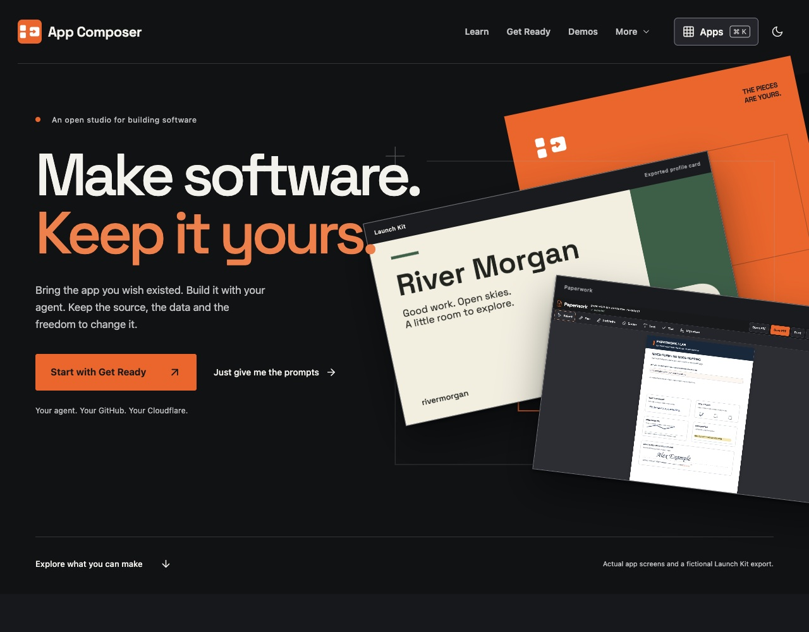
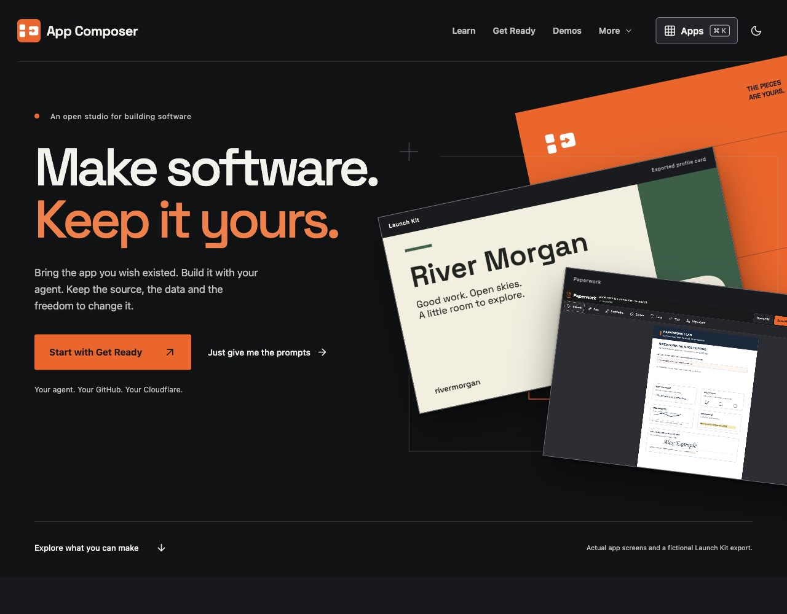
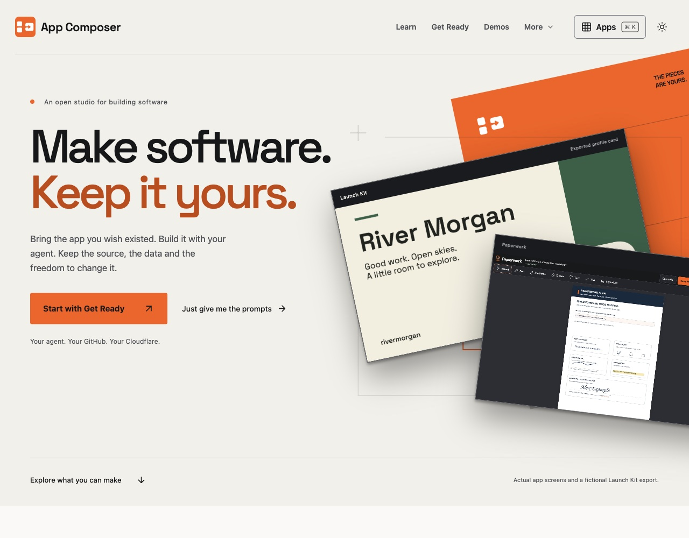
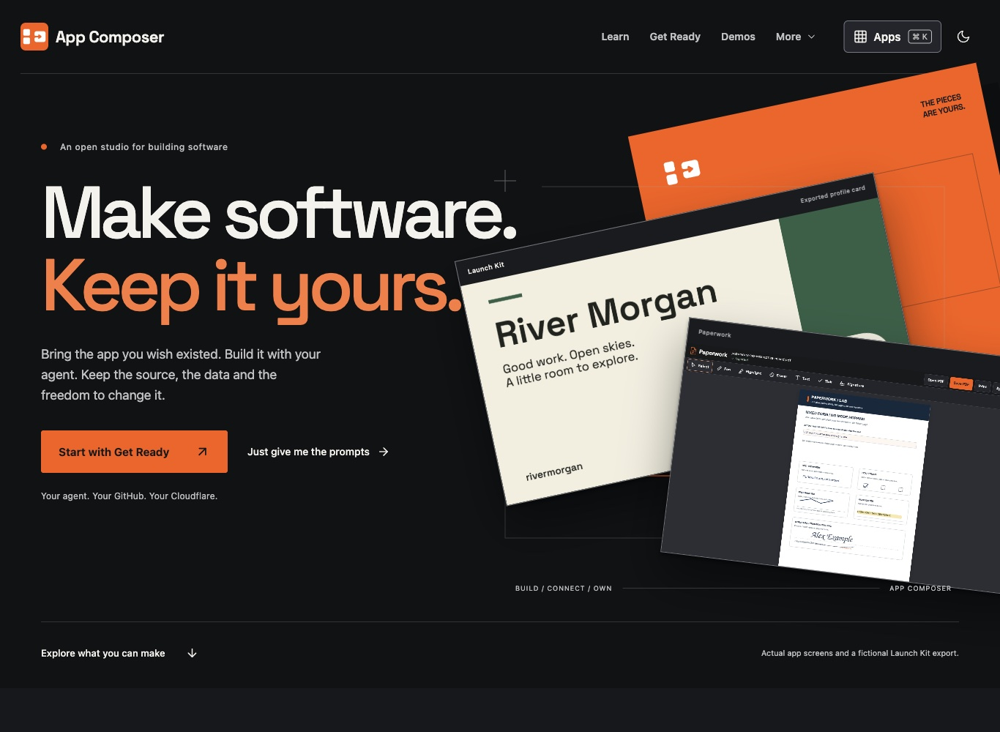
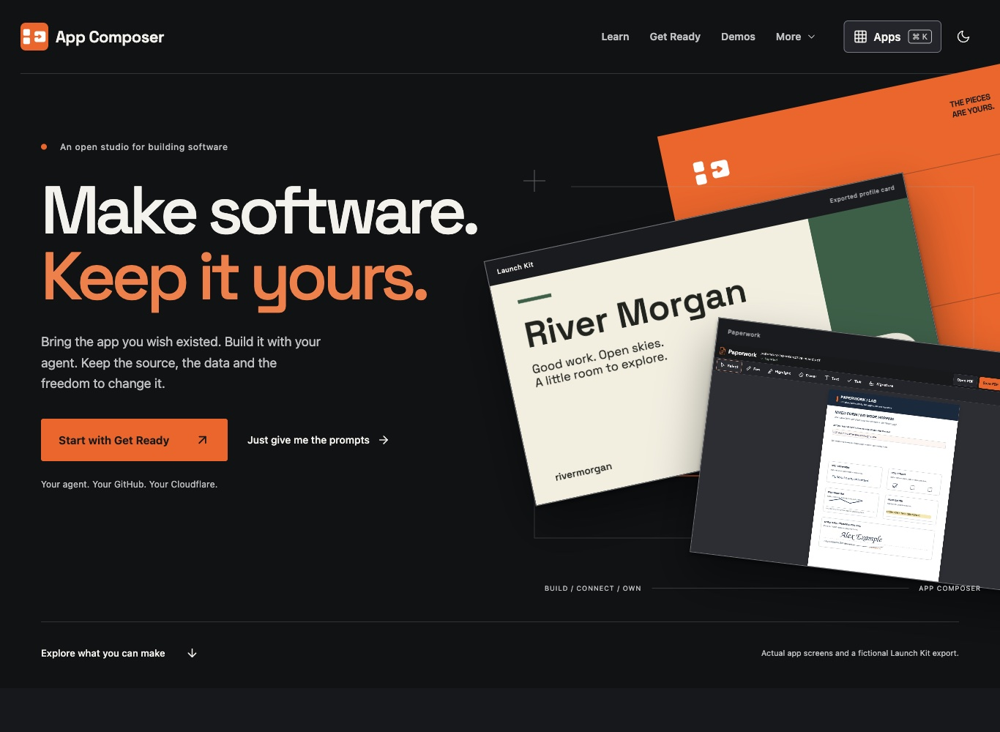
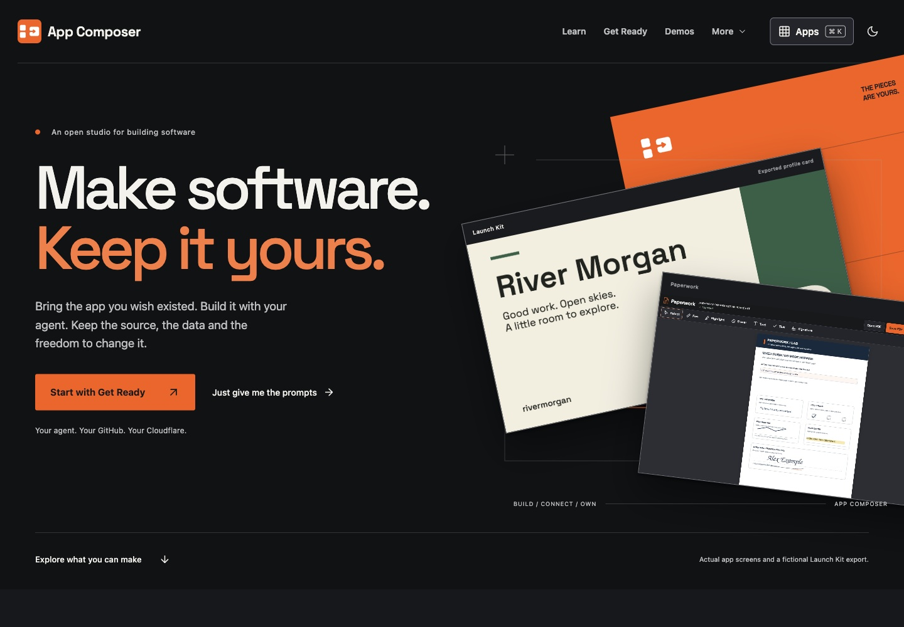

# Homepage hero overlap correction — live evidence

Released **2026/11/11 05:43 AEDT** (Australia/Melbourne, UTC+11) / **2026/11/10 18:43 UTC**.

| Item | Value |
| --- | --- |
| Repository | `loftwah/app-composer` |
| Pull request | [#424](https://github.com/loftwah/app-composer/pull/424) |
| Product issue | [#7](https://github.com/loftwah/app-composer/issues/7) |
| Released source | `6ae87756f3b08dda0c719242b779f3455cb83e7c` |
| Live `/build.json` | `6ae87756f3b08dda0c719242b779f3455cb83e7c` |
| Worker | `app-composer`, version `008f8325-1b3a-4d3f-a997-1756ee4919b2`, 100% traffic |
| Live URL | <https://composer.loftwah.com/> |

## The defect

At roughly 1201–1540px the “Make software. / Keep it yours.” headline ran
into the rotated Launch Kit card. The collision was clearest at 1280px, where
“Keep it yours.” sat over the card and its “Launch Kit” label, and at 1366px.
The 1440px layout was only just clear.

## The correction

A single intermediate-desktop media query now keeps the copy and the sheets
apart:

- 1201–1540px: the hero headline uses `6.7vw` instead of `7.3vw`, and the
  assembly scene shifts 40px right (`right: -190px`).
- 1440px and the phone layout keep the established scale; below 1201px the
  existing 1200px layout already clears the copy.
- Above 1540px the base layout is clear again.

Measured text line boxes no longer intersect the rotated Launch Kit card at
1201, 1280, 1366, 1440, 1500, 1520, 1540 or 1541px.

## Verification

- Reproduced the live collision at 1280 and 1366, then verified the released
  fix at the widths above.
- Live 1280px dark and light, 1366px dark and 1440px dark inspected.
- No horizontal overflow; theme, gallery, launcher and reduced-motion behaviour
  are unchanged.
- `pnpm run check:types`: 0 errors, 0 warnings, 79 existing hints; CSS passes
  Prettier.
- `pnpm deploy` from clean pushed main: audit, required checks, production
  build, D1 migrations, Worker upload, live source/pinned services, sharing,
  publication privacy, anonymous admin boundary and release record all passed.
  Recorded release elapsed time: 107.7 seconds.

## Screenshots

All “after” captures are from <https://composer.loftwah.com/> on the released
source. “Before” captures are from the previous live release and show the
collision.

### 1280px

### 1366px

### 1440px

## Scope

This is a geometry-only correction to the public homepage hero. The deployed-app
captures, fictional Launch Kit export, orange brand surface and app identities
are unchanged. Physical-device and screen-reader acceptance remain separate
gates. #7 owns the public experience and #11 owns the shared release evidence.
