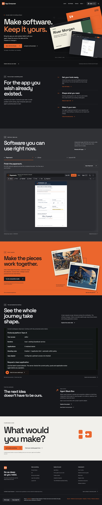
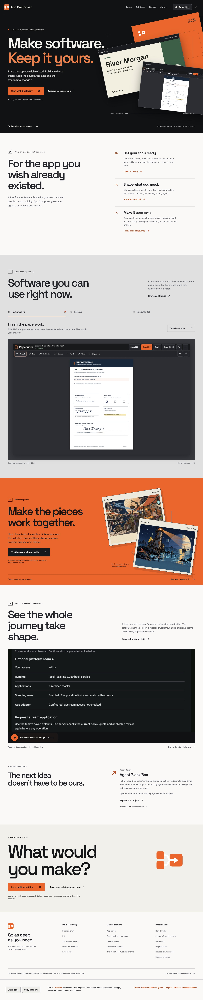
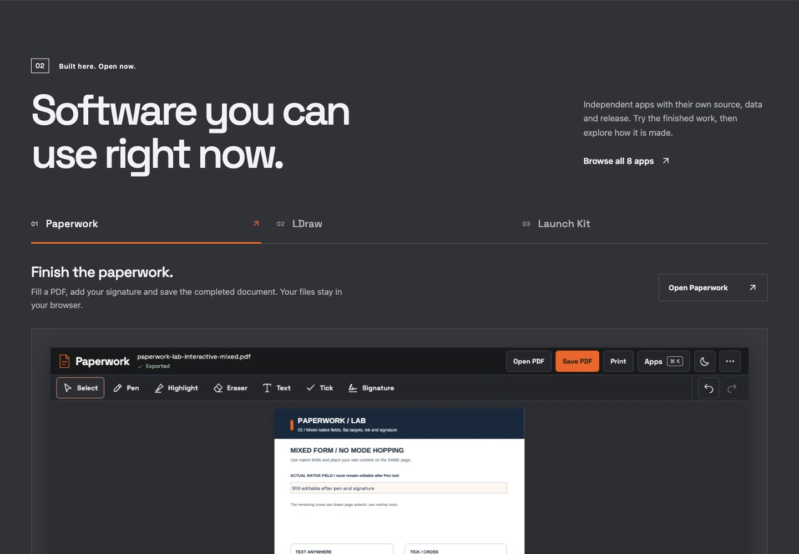
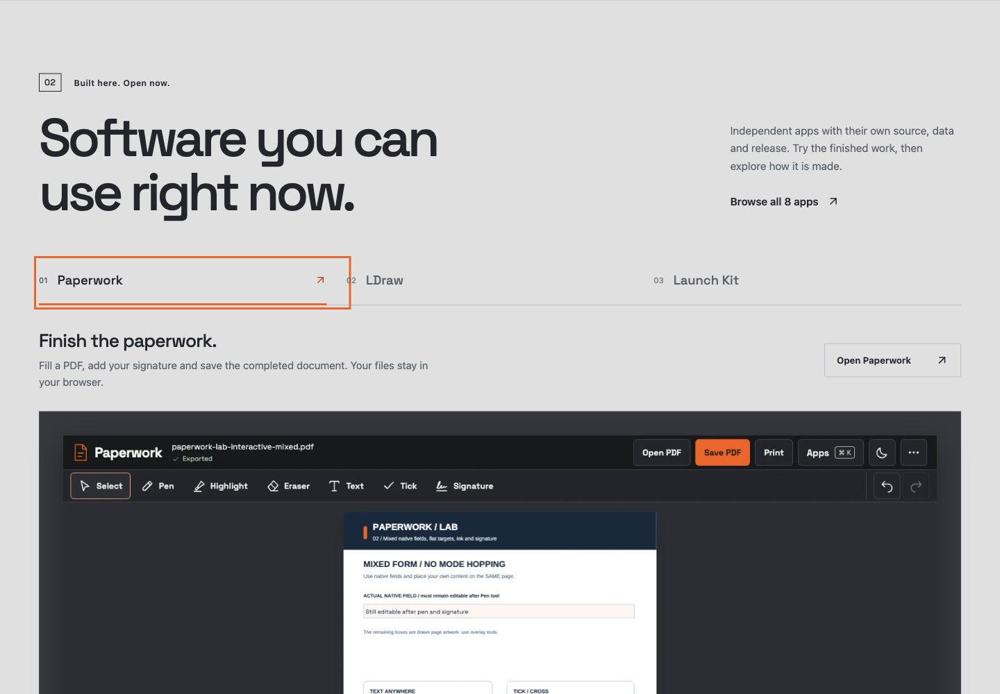
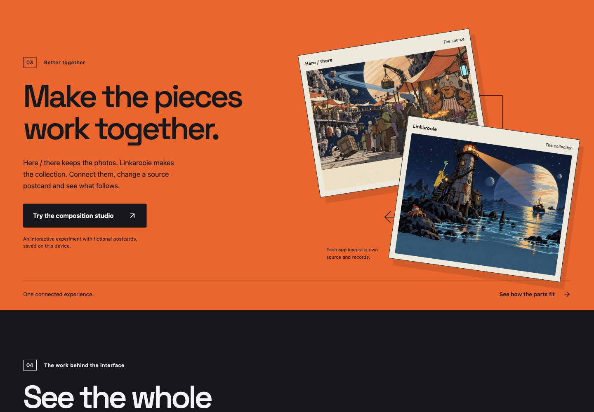
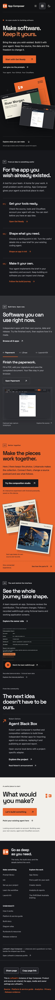
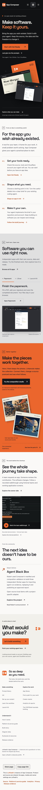
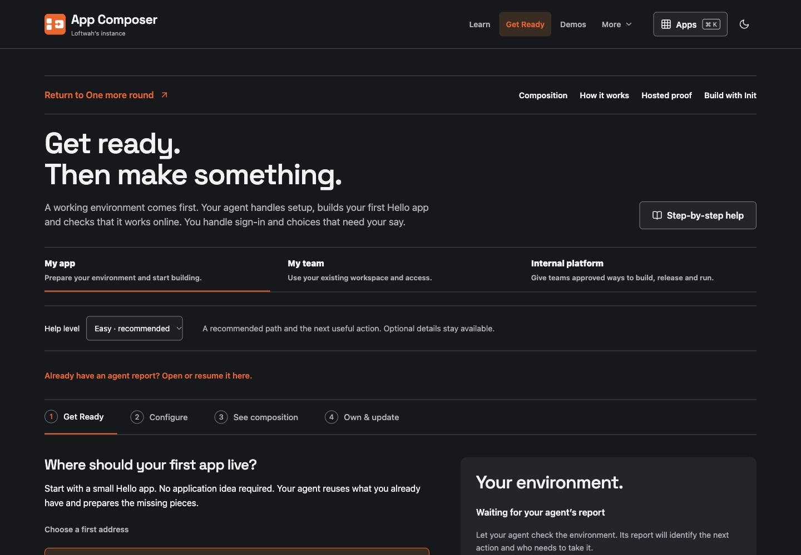

# Homepage redesign — live evidence

Released **2026/11/11 01:02 AEDT** (Australia/Melbourne, UTC+11) / **2026/11/10 14:02 UTC**.

| Item | Value |
| --- | --- |
| Repository | `loftwah/app-composer` |
| Pull request | [#421](https://github.com/loftwah/app-composer/pull/421) |
| Product issue | [#7](https://github.com/loftwah/app-composer/issues/7) |
| Released source | `eae5f9eccc6fd5d4e7354f9daec3a42e27fb3e83` |
| Live `/build.json` | `eae5f9eccc6fd5d4e7354f9daec3a42e27fb3e83` |
| Worker | `app-composer`, version `a32a8b5b-c191-46bd-9fdf-812dccce8801`, 100% traffic |
| Live URL | <https://composer.loftwah.com/> |

The release used the repository's existing clean pushed-main path: `pnpm deploy`
ran the dependency audit, required checks, production build, remote D1
migrations, Worker upload, live source/pinned-service verification, sharing
output, publication privacy and the anonymous administration boundary. The
recorded release elapsed time was 97.9 seconds.

## What shipped

- A full-width ink/orange opening with the “Make software. Keep it yours.”
  headline, composed from an actual deployed Paperwork capture and the existing
  fictional Launch Kit “River Morgan” export.
- A three-step build journey, a large Paperwork/LDraw/Launch Kit gallery with
  real deployed-app captures and visible capture dates, and a connected
  Here / there + Linkarooie postcard composition.
- The existing recorded team walkthrough, accurately attributed community work
  (Robert DeVore / Agent Black Box), a closing action and the deeper-link index.
- The approved orange-and-white merging-block mark, local Space typography,
  native navigation/theme/launcher, product routes and independent app
  identities remain in place. No new dependency or raster asset was added.

## Verification

- **Desktop:** 1440×1000 full page, dark and light.
- **Phone:** 390×844 full page, dark and light; document width equals the
  viewport (no horizontal overflow).
- **Intermediate widths:** 1024, 768, 600 and 320 px checked for overflow and
  hero composition.
- **Gallery:** mouse selection and keyboard `ArrowRight`/`ArrowLeft`, `Home` and
  `End` move focus, selection and the visible panel together. All three panels
  remain present in the server-rendered HTML with ordinary `#work-*` links and
  no `hidden` attributes when JavaScript is unavailable.
- **Theme:** the control switches both themes, updates its pressed state and
  persists the choice through `composer-theme` after reload.
- **Launcher:** opens from the header, filters (“Init” → one destination),
  closes with Escape, and `Cmd/Ctrl+K` opens it with focus in search.
- **Focus:** the skip link appears above the presentation header and the first
  keyboard tab order is skip → brand → navigation → launcher → theme → hero
  action.
- **Reduced motion:** the full page is visible with entrance motion disabled.
  The screenshots below use this setting so every section is captured.
- **Woodhouse builder context:** `/ready?from=woodhouse-edition` shows the
  “Return to One more round” strip in normal flow, a static header and the
  retained composition/proof/Init links.
- **Main journeys:** `/ready`, `/init`, `/prompts`, `/demo`, `/paperwork` and
  `/launch-kit` all returned 200 with their expected page identity. `/ldraw`
  redirects 302 to <https://ldraw.loftwah.com/> (200).
- **Console:** the only error is the known Cloudflare Insights beacon blocked by
  the page CSP; there were no page exceptions or failed local assets.

## Screenshots

All captures are from <https://composer.loftwah.com/> on the released source.

### Desktop, 1440 px

### Phone, 390 px

### Builder context

## Scope and remaining gates

The deployed-app screenshots are actual captures of the named apps; the Launch
Kit export, demo postcards and team walkthrough data are explicitly fictional.
This evidence covers the affected public homepage and its live routes. Physical
device, screen-reader speech and external unfurl acceptance remain separate
gates. #7 owns the public experience and #11 owns the shared release evidence.
