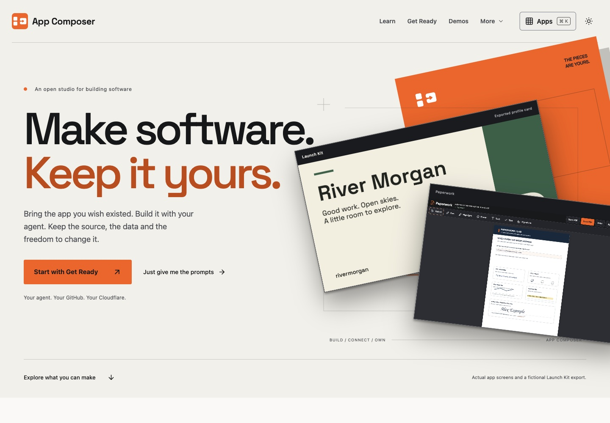
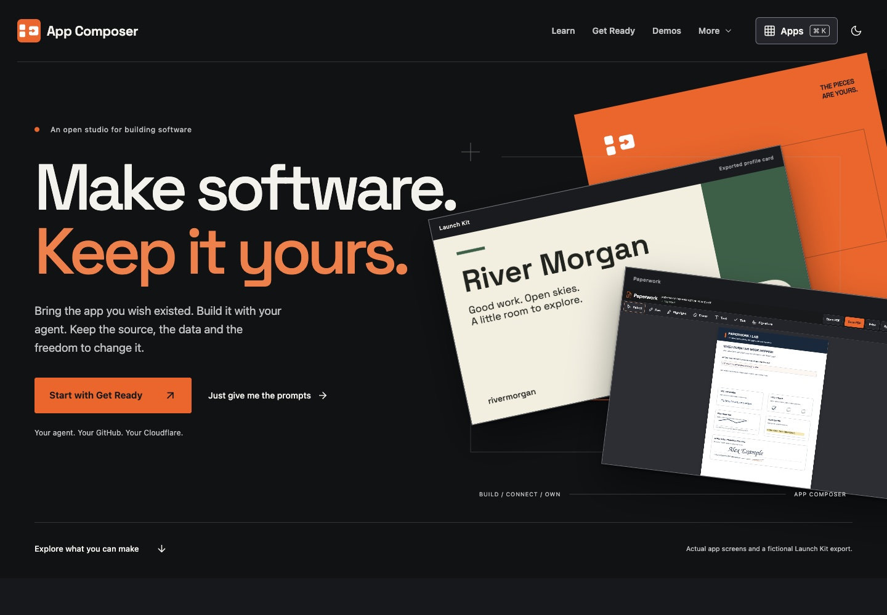
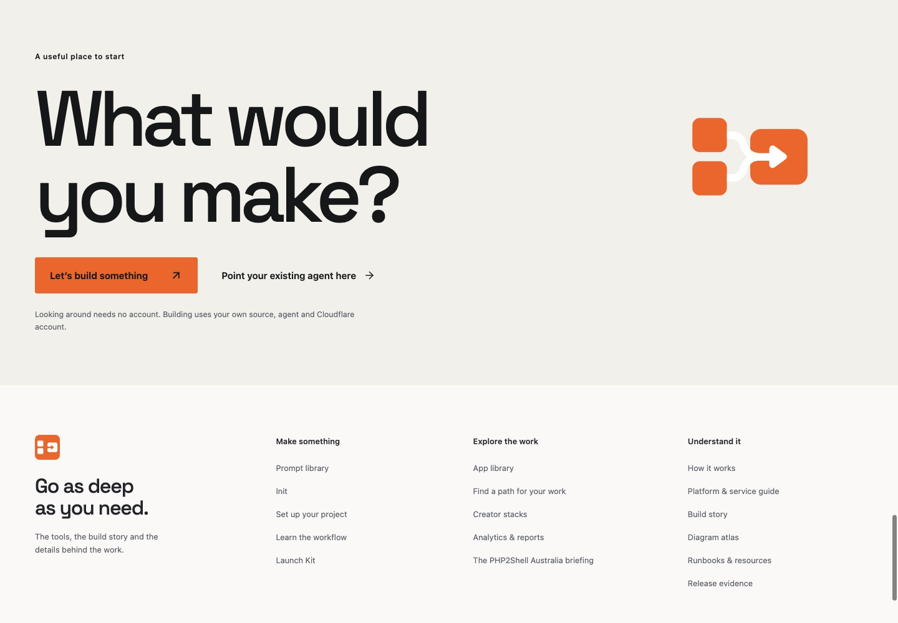
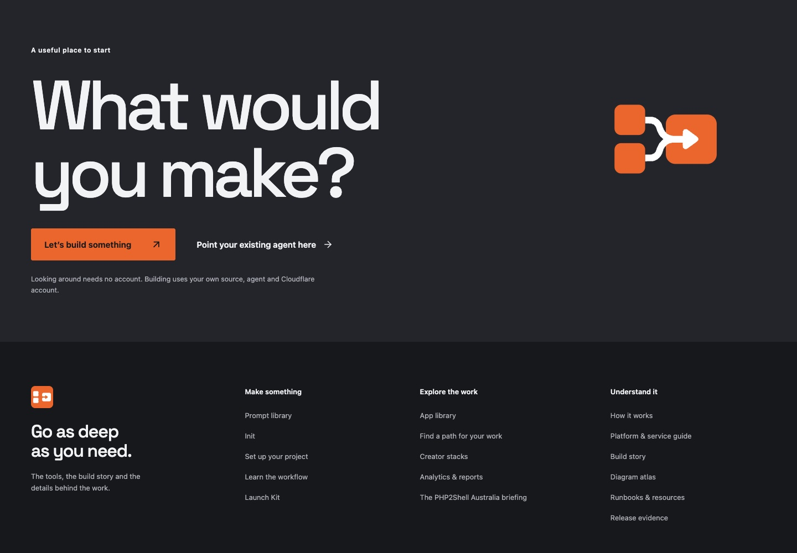
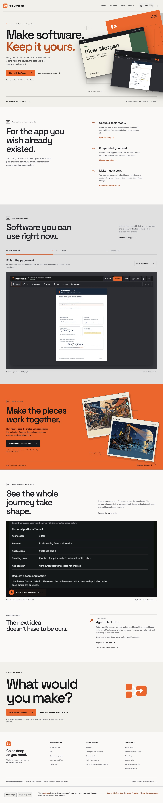
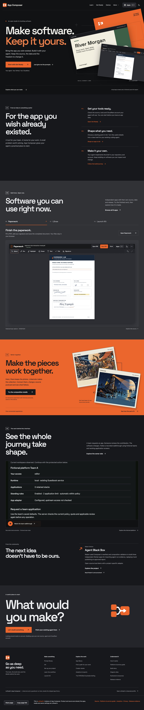
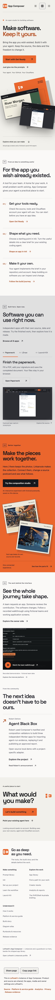
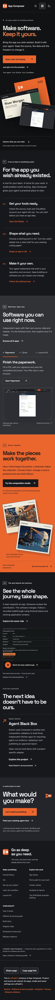

# Homepage theme correction — live evidence

Released **2026/11/11 03:07 AEDT** (Australia/Melbourne, UTC+11) / **2026/11/10 16:07 UTC**.

| Item | Value |
| --- | --- |
| Repository | `loftwah/app-composer` |
| Pull request | [#423](https://github.com/loftwah/app-composer/pull/423) |
| Product issue | [#7](https://github.com/loftwah/app-composer/issues/7) |
| Released source | `7c0353e09e83e1b121c591699c87d996ef6909de` |
| Live `/build.json` | `7c0353e09e83e1b121c591699c87d996ef6909de` |
| Worker | `app-composer`, version `1f03cf33-e073-4096-b2ba-089dd5a3def2`, 100% traffic |
| Live URL | <https://composer.loftwah.com/> |

## The defect

The toggle changed `data-theme` and the lower sections, but the opening was
hard-coded to ink and the header used hard-coded dark control tokens. In light
mode the first screen therefore stayed dark and the toggle looked broken. The
closing “What would you make?” panel stayed paper-light in dark mode, leaving a
light block on an otherwise dark page.

## The correction

- The opening and closing panels now follow the active theme. Dark mode uses ink
  with light text; light mode uses warm paper with dark text.
- The header uses the active theme’s control tokens: dark text, a light Apps
  control and a light “More” panel in light mode; light text and dark controls
  in dark mode.
- The light opening uses the darker `#c74400` accent for “Keep it yours.”; the
  dark opening keeps `#ff793b`.
- The orange assembly plane, actual Paperwork capture, fictional Launch Kit
  export and dark app sheets remain constant brand/app surfaces.
- The orange composition remains a brand surface with dark text in both themes.

## Verification

- Live 1440×1000 and 390×844 full pages in both themes.
- Live text/background contrast audit: **0 failures in dark mode and 0 failures
  in light mode**.
- Header, “More” panel and Apps launcher checked in both themes.
- Toggle state and `aria-pressed` update; the choice persists through
  `composer-theme` after reload.
- No horizontal overflow at 390px.
- `pnpm run check:types`: 0 errors, 0 warnings, 79 existing hints; CSS passes
  Prettier.
- `pnpm deploy` from clean pushed main: audit, required checks, production
  build, D1 migrations, Worker upload, live source/pinned services, sharing,
  publication privacy, anonymous admin boundary and release record all passed.
  Recorded release elapsed time: 127.3 seconds.

## Screenshots

All captures are from <https://composer.loftwah.com/> on the released source.
They use reduced motion so every section is visible.

### Opening and closing, 1440 px

### Full page, 1440 px

### Full page, 390 px

## Scope

The deployed-app captures remain actual captures of the named apps; the Launch
Kit export, demo postcards and team walkthrough data are explicitly fictional.
Physical-device and screen-reader acceptance remain separate gates. #7 owns the
public experience and #11 owns the shared release evidence.
