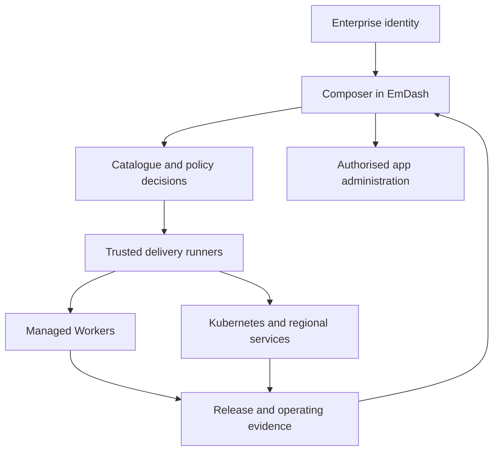
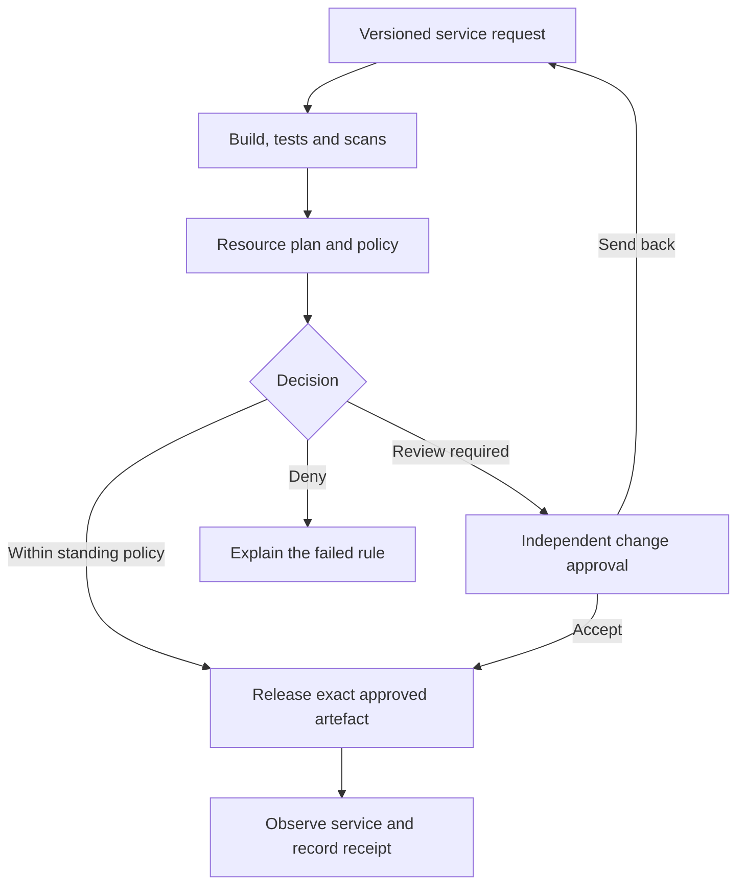

# App Composer as an enterprise application platform

Research reviewed **2026/10/23 AEDT (Australia/Melbourne, UTC+11) / 2026/10/23 UTC**.

This guide answers how App Composer could support a business platform, where Workers and Kubernetes fit, and which integrations and assurance evidence would be required. It combines an inspection of Composer source with current primary documentation. It is an architecture and qualification guide, not a declaration that every described deployment or connector is supported.

Source baseline: [`29fc65c2983769f140bad3bdef298a20c0185b0e`](https://github.com/loftwah/app-composer/tree/29fc65c2983769f140bad3bdef298a20c0185b0e). This identifies the inspected source; production release evidence remains in [#11](https://github.com/loftwah/app-composer/issues/11). Newer source, provider features, contractual terms and deployment evidence must be checked before implementation.

## 1. The practical answer

App Composer can become the place where a team requests an application, receives approved resources, manages its content and configuration, sees releases and operating health, and retires the service safely. The business can adopt that operating model while keeping workloads on several suitable runtimes. This is the proposed Platform Teams extension in [#216](https://github.com/loftwah/app-composer/issues/216).

The first useful target is a governed internal platform. Commercial hosting for mutually untrusted customers has additional identity, isolation, abuse, billing, support and contractual requirements. A two-team internal demonstration does not settle those requirements.

| Question | Answer and current evidence boundary |
| --- | --- |
| Can a business move its services to this model? | It can progressively adopt a catalogue, ownership, policy and delivery model. Runtime or data migration is a separate decision for each service. The full enterprise workflow remains proposed. |
| Is Workers suitable? | It is a credible candidate for compatible web applications, APIs and event-driven services. Evaluate each workload's limits, data needs and operating controls. Cloudflare publishes an enterprise platform reference architecture [P1]. |
| Can I run Composer on Kubernetes? | There are plausible celld and Node.js routes. Neither is qualified for this Composer source snapshot. The binding, identity, state and recovery inventory below defines the work. |
| Can it use AWS, Azure and Google Cloud? | Hybrid integration is feasible in principle; self-hosted runtime candidates also exist. Provider-supported primitives do not establish a tested Composer adapter. |
| Does it replace EKS, Jenkins, Vault or ServiceNow? | Its proposed role is to connect approved requests to those systems and expose their outcomes. Existing owners and authorities remain explicit. |
| Does GitOps work? | Kubernetes workloads can use Argo CD. Workers need an appropriate deployment/reconciliation adapter. Git storage alone does not establish GitOps [S2]. |
| Does EmDash provide the whole platform? | EmDash supplies the administration and content foundation. Composer adds application contracts and scoped lifecycle controls; a trusted execution boundary performs infrastructure changes. |
| Is it enterprise ready or compliant? | Supplier assurance supports evaluation. Composer still needs demonstrated controls and workload-specific acceptance. No blanket enterprise-readiness, SOC 2 or Australian-compliance claim is established. |

## 2. What exists in the inspected Composer source

The [architecture](https://github.com/loftwah/app-composer/blob/29fc65c2983769f140bad3bdef298a20c0185b0e/ARCHITECTURE.md), [runtime configuration](https://github.com/loftwah/app-composer/blob/29fc65c2983769f140bad3bdef298a20c0185b0e/wrangler.jsonc), [Astro configuration](https://github.com/loftwah/app-composer/blob/29fc65c2983769f140bad3bdef298a20c0185b0e/astro.config.mjs) and [workspace guide](https://github.com/loftwah/app-composer/blob/29fc65c2983769f140bad3bdef298a20c0185b0e/docs/workspace-access.md) establish these source-level facts:

- Composer is an Astro/EmDash Worker. The inspected packages pin EmDash 1.2.0 and the Cloudflare adapter; native Composer administration plugins run in the trusted server process.
- The deployment uses D1 `DB`, R2 `MEDIA`, KV `SESSION`, independently pinned `GUESTBOOK` and `SHOWCASE` service bindings, scheduled work and a rate-limit binding.
- Owner administration uses Cloudflare Access and EmDash permissions. Composer adds workspace owner/editor/viewer membership checks. Workspace invitations do not admit a new person through Access or grant global infrastructure permissions.
- Independent apps retain their source and data ownership. Updating a standalone app does not silently promote it into the composed deployment.
- Get Ready and the existing local execution adapters perform bounded readiness and deployment operations. Public HTTP is not a general build/deploy endpoint. A portable specification or receipt does not grant authority.
- The repository already has release, provenance and configuration-recovery controls. Its documentation separately records incomplete data/media recovery and customer-admission acceptance.

No qualification of Kubernetes, celld, cross-cloud failover, enterprise SSO provisioning, or the third-party integration catalogue below was performed for this guide. The source audit is deliberately narrower than a production acceptance claim.

## 3. Moving a business to the model

### Start with a service inventory

For each service, record its business owner, technical owner, users, data classification, runtime and protocols, dependencies, existing controls, availability target, acceptable downtime/data loss, current cost and exit constraints. Include SaaS subscriptions and externally managed services in the catalogue; listing them does not mean moving their implementation into Composer.

Assign a justified outcome:

| Outcome | Typical reason | First useful action |
| --- | --- | --- |
| Keep and register | Existing service works and migration has little value. | Add ownership, runbook, change and incident references. |
| Integrate | A useful service should be available to a new app. | Define a narrow authenticated API, permission and data contract. |
| Replatform | The application fits another runtime with manageable changes. | Prove one representative journey and its data migration in isolation. |
| Refactor | Runtime, state or business logic must materially change. | Establish a measurable business case and a reversible transition. |
| Replace or retire | The service is redundant or the approved catalogue covers it. | Export required data, account for consumers and follow retention rules. |

This classification is a proposed migration method. It prevents a platform programme from becoming an indiscriminate rewrite.

### A phased adoption path

1. **Catalogue existing services.** Establish owners, environments and operating links. Keep the business running on its current infrastructure.
2. **Prove one golden path.** Choose a useful, low-risk internal app. A golden path is a maintained recipe with supported resources, permissions, checks and recovery. Deliver request through verified operation.
3. **Exercise a second team.** Prove denied cross-team access and independent releases. Successful use by an administrator does not establish delegated self-service.
4. **Connect existing delivery and operations.** Reuse Jenkins/Terraform, identity, secret management, change records and incident ownership where the organisation already has them.
5. **Qualify additional runtime targets.** Reuse the same application contract and fixtures while making target differences visible.
6. **Migrate selectively.** Move a service only when its compatibility, recovery, cost and business value justify the work. Test a return or exit path before relying on portability.

### Why use Composer instead of doing this directly?

Use it if it measurably reduces repeated work: locating an approved template, asking who owns a resource, assembling permissions, applying release rules, finding a failed deployment, collecting evidence, or safely retiring a service. The proposed value is consistency and a useful service lifecycle for humans and agents.

Direct Wrangler, Terraform, cloud consoles, Kubernetes and an existing developer portal remain legitimate choices. A small team with one application may need only its existing scripts. An organisation with a mature platform should compare the incremental benefit against another portal to operate. Composer must earn adoption through reduced lead time, clearer ownership, fewer manual steps and safer recovery, rather than through a large integration-logo page.

Measure total operating cost, including engineering/on-call effort, minimum compute, database/storage, backups, network transfer, logs, security licences, support, migration and exit. Do not compare a Workers entry-plan price with a fully staffed Kubernetes platform or claim universal savings from synthetic request counts. [#170](https://github.com/loftwah/app-composer/issues/170) retains cost-evidence ownership.

## 4. EmDash, self-service and IAM

### The proposed responsibility model

The diagram describes a target architecture. Content editing and infrastructure deployment have different authorities. A native EmDash page can display a request and call an authorised API; it should not receive unrestricted cloud credentials merely because it is an admin page. Cloudflare's enterprise reference distinguishes development, deployment and production responsibilities [P1].

EmDash offers native React administration extensions and authentication facilities [P2], [R19]. Composer should reuse those surfaces for service ownership, resource requests, releases, outcomes and maintenance. Application records remain with the independent app. A central portal can hold identifiers and grants without becoming the database owner for every service.

### Six permission domains

| Domain | Question it answers | Example |
| --- | --- | --- |
| Identity provider | Who is this person or workload? | Company SSO, MFA and account lifecycle. |
| EmDash administration | Which CMS/admin capabilities can they use? | Edit content or manage trusted plugins. |
| Composer authorisation | Which team/app/environment actions are allowed? | Request staging resources; view one workspace. |
| Delivery identity | Which provider changes may this runner perform? | Deploy one existing Worker; provision an approved resource class. |
| Runtime capability | What may the running application access? | One database binding or authenticated internal API. |
| Application user access | Which business records/actions may an end user use? | Read their profile; approve a purchase within their limit. |

These are separate checks. SSO admission is not production-approval authority. An EmDash editor is not automatically a cloud administrator. A runtime binding is not a human role.

The proposed enterprise extension should identify organisation/team/app/environment/resource scopes, explicit allow/deny decisions, workload principals, independent approvers where required, short-lived elevation and audited emergency access. Reuse existing workspace roles as the starting point. Do not invent working SCIM, group synchronisation, custom roles or offboarding automation until their exact paths are tested. Revocation must cover app sessions and alternate login methods as well as the directory account; EmDash documents a session/passkey caveat for its Microsoft login flow [R19].

Cloudflare now supports individual-Worker permissions for members, groups and tokens. Creation needs broader authority, and domains have separate restrictions. Crucially, someone allowed to deploy a Worker can change code using its existing bindings without separate direct permissions on the bound database or bucket. Therefore narrow deployment scope still gives powerful access to that app's data. Separate builds from release credentials and constrain bindings [S31].

Composer currently validates Access JWTs. Newer `ctx.access` facilities have topology limitations, including service bindings and Static Assets routing. They should be evaluated against the actual Astro deployment before any authentication change [S32], [S33].

### What a resource request should produce

A request for an internal API might select a reviewed recipe, owning team, staging environment, approved database class and retention policy. The server validates those inputs, checks identity/policy/quota, and produces a concrete plan. The trusted runner provisions or binds resources and records provider identities. The requester receives the application URL, authorised admin, owner record, release receipt, logs, limits and recovery instructions.

The lifecycle includes update, rotate credentials, change capacity, export, transfer ownership, suspend and retire only where supported. Each operation needs current permission, a stable operation ID, recorded outcome and recovery from ambiguous completion. Deleting a service must account for shared resources, retention, backups and consumers. A delayed API acknowledgement must not create a duplicate database.

## 5. Workers, Kubernetes and the public clouds

### Choose the runtime per workload

| Model | Good candidate use | Main responsibility or limitation |
| --- | --- | --- |
| Managed Workers | Compatible sites, APIs, edge logic and bounded event-driven work. | Qualify runtime APIs, limits, data services, location and recovery. |
| Workers plus regional backends | New interfaces over existing databases and business systems. | Secure connectivity, cross-provider latency/failure and separate data ownership. |
| Kubernetes containers | Existing container applications, specialised runtimes, private services and established cluster operations. | Workload security, upgrades, state, capacity and on-call responsibilities remain. |
| Node.js EmDash/Composer port | A conventional container deployment retaining EmDash administration. | Port Composer's direct platform dependencies and prove multi-instance behaviour. |
| celld fleet | Preserve more of the Workers programming model on controlled infrastructure. | Qualify beta compatibility, trusted tenancy, storage guarantees and operations. |

EKS, AKS and GKE provide managed Kubernetes capabilities [R24], [R25], [R26]. They do not supply Composer's specific app composition, catalogue or lifecycle. Conversely, Composer should not pretend to replace the general container scheduler or the infrastructure team's established controls. Use the pair when both earn their place.

Kubernetes is attractive when existing skills, policies and private networking already make it an efficient home; when container/runtime flexibility matters; or when infrastructure placement and operating control are requirements. It is less attractive when a small compatible application would gain no material benefit from a cluster and the team would inherit substantial maintenance.

Cloudflare Containers is another documented execution option alongside Workers [R23]. It is not proof of Kubernetes equivalence, persistent database suitability or an automatic migration path for brokers and legacy servers. Assess its lifecycle and storage separately.

### What changed in self-hosting

Plain `workerd` supplies the JavaScript/Wasm runtime and related capabilities; it is not the entire managed Cloudflare service. Its own security guidance requires additional isolation for potentially malicious code [R12].

The current celld compatibility matrix is much broader: it lists Workers, distributed Durable Objects, D1, R2, KV, Queues, Workflows, static assets, cron and Dynamic Workers, with specific differences. Containers are experimental; several other Cloudflare products are absent. Unknown Wrangler keys can stop deployment, while some accepted compatibility flags have no effect. A successful deployment therefore does not establish matching runtime behaviour. This makes a celld qualification meaningful, while ruling out an untested claim of unchanged deployment [R3].

Cloudflare's Deno announcement describes a plan to combine celld and workerd and improve self-hosting support [R1]. That roadmap is separate from what current released software supports. The release listing and documentation banner also differ: v0.6.3 appears in releases while several pages identify v0.6.2 beta. Pin the candidate release/image and its documentation; do not infer support from a floating tag [R4].

celld's documented trust model is one trusted application per fleet. It does not provide a hostile multitenant account platform. Its private network and fleet-bucket credentials are security boundaries; public TLS is supplied externally [R5], [R6]. A Kubernetes namespace alone does not establish isolation for mutually distrusting tenants [R27].

### Two concrete Kubernetes candidates

**Candidate A: celld.** Build the existing Worker application, generate a target-specific configuration, deploy a trusted fleet with private peer communication and a qualified object store, and provide ingress/TLS, workload identity, resource controls, monitoring and recovery. Keep operator interfaces private. Verify the selected bucket or fleet acknowledgement mode. Production fleets still require qualified object storage; follower disks can contain acknowledged writes that have not yet reached the bucket, so rollout and recovery procedures must preserve them. An arbitrary S3-compatible endpoint is not automatically qualified [R7].

**Candidate B: Node.js.** Use the official EmDash Node path with an Astro Node server image, an appropriate external database and media service, shared sessions and coordinated scheduled work. EmDash documents Node/Docker, PostgreSQL/libSQL and S3-compatible storage options [R8], [R10], [R11]. Composer's direct D1 code and service bindings still require deliberate adapters. Several replicas sharing an SQLite file over a network filesystem are not a demonstrated HA design.

EmDash can run sandboxed plugins using a workerd child process on Node or Worker Loader on Cloudflare. Native plugins run in-process. The Node runner enforces wall time but does not enforce the Cloudflare runner's CPU and subrequest budgets. The Cloudflare sandbox database bridge currently directly requires D1; the documented Hyperdrive route does not support those sandboxed plugins [R9]. Test the plugin behaviour actually required by the application.

### Composer's porting inventory

| Dependency | celld candidate | Node/container candidate | Acceptance evidence |
| --- | --- | --- | --- |
| Worker build and assets | Run generated bundle with compatible imports and configuration. | Change runtime adapter and dependent code. | Real public/admin/API journeys and correct asset URLs. |
| D1 and custom SQL | D1-compatible binding plus explicit import. | Selected SQL adapter; port direct D1 calls. | Schema, transactions, migrations, failures and restoration. |
| R2 media | Fleet-bucket-backed binding. | Supported media adapter/API. | Metadata, access, uploads, deletion and recovery. |
| KV sessions | Supported KV with different semantics. | Shared session implementation. | Expiry, logout and revocation across replicas/restarts. |
| Service bindings | Qualify fetch/RPC and packaging. | Authenticated internal service adapter. | Exact source/data ownership, errors and denied cross-app access. |
| Cron | Main-script schedule support. | Coordinated worker or scheduler. | Duplicate/missed invocation handling and persistence. |
| Access | Retain external Access or qualify an alternative. | Same deliberate identity decision. | Origin bypass denial and validated identity. |
| Rate limiting | No matching binding in the documented compatibility set. | Approved gateway/app implementation. | Effective denial preserved; no silent unrestricted fallback. |
| Routes, TLS and provider controls | Target ingress/configuration required. | Container ingress/configuration required. | Correct hosts, trusted headers, rotation and release identity. |

celld D1 lacks managed D1 read replicas, Time Travel and REST API [R13]. Its KV consistency/cache behaviour differs [R14]. R2 URL and multipart recovery semantics differ [R15]. Cron does not run for service-binding target Workers [R16]. These are separate operational tests, not reasons to invent a universal compatibility percentage.

### AWS, Azure and Google Cloud mappings

| Cloud | celld candidate | Conventional Node candidate |
| --- | --- | --- |
| AWS | EKS/EC2 plus S3; upstream documents EKS Pod Identity. | Container/VM hosting plus selected PostgreSQL and S3 services. |
| Azure | AKS/VM plus Azure Blob; upstream documents workload identity. | Container hosting plus selected database and explicitly supported media interface. |
| Google Cloud | Candidate GKE/VM deployment using upstream GCS/Application Default Credentials support; qualify the exact workload identity and scheduling configuration. | Container hosting plus selected database and explicitly supported media interface. |
| Own infrastructure | Qualified compute, private network and object store. | Node/container host, persistent services and complete operator controls. |

The celld provider paths are upstream documentation, not executed Composer recipes [R2]. EmDash's S3 adapter does not by itself prove native Azure Blob or GCS compatibility. Record any retained Cloudflare dependency, including Access, DNS, storage or release control.

## 6. Multicloud, connectivity and exit

Distinguish four goals: **use services from multiple clouds**, **redeploy an application elsewhere**, **recover after loss of a provider**, and **operate state actively across providers**. Each needs different evidence. A second compute provider using the same object store is not independent disaster recovery. A portable image without its state, identities and secrets is not a working exit plan.

The recommended first design is hybrid integration plus a tested exit/recovery route. Keep one authoritative system for each data set and resource property. Use versioned contracts, bounded retries, idempotency, explicit timeouts and observable partial failure. Quantify latency and transfer cost for chatty database calls; avoid an architecture where every user action depends synchronously on several clouds without a business reason.

Workers VPC provides private HTTP and raw TCP paths to connected infrastructure, with per-service and broader network bindings. It is currently documented as beta. The VPC Network `connect()` path currently supports plaintext TCP only; a private tunnel does not establish end-to-end application TLS. Qualify the selected HTTPS/service/gateway path and destination restrictions [S4], [R17], [R18].

A portability or recovery proof should include:

- Export application configuration, database and media with the correct identities and retention state.
- Restore to an isolated alternative, verify record counts/content and denied private access, and exercise the real app journey.
- Recover required service identities, DNS/ingress and secrets through documented custody; exclude secrets from portable public specs.
- Measure recovery time and data loss against agreed objectives.
- Prove operation when the original compute/control plane is unavailable; list any remaining common dependency.
- Reconcile or reject writes made during the cutover, and define the safe return path.

Active-active state across providers should follow only from a demonstrated requirement and a tested conflict/consistency model. A Terraform plan spanning providers does not make their APIs a transaction.

## 7. SDLC, policy pipelines, CI/CD and GitOps

### A proposed delivery contract

CI validates source and creates a candidate. CD promotes an approved candidate and verifies its environment. GitOps adds continuous reconciliation from declared desired state. These responsibilities can use the organisation's existing tools.

This is a proposed workflow; the diagram does not claim a working enterprise pipeline.

Bind a decision to the requester, target account/environment, source commit, artefact digest, resource-plan digest, policy version, test/scan evidence, approver and expiry. Recheck these immediately before applying a change. A send-back, changed plan, expired approval or revoked role must not reuse the old authority. A browser button should show this state, not determine it.

Requesters must not be able to rewrite the policy bundle, approval rules or trusted job definition that authorises their own change. Changes to those controls need a separate reviewed path. A protected Jenkinsfile alone does not make untrusted build code safe to run with credentials [S38].

Builds do not receive production credentials. A trusted planner evaluates the required changes. A separate release identity receives only the scope required for the operation. The runner records provider resource/version IDs and performs independent health verification. API acceptance, completed rollout and healthy service are separate states.

Policy examples include permitted templates, ownership, approved regions, data classification, public exposure, resource limits, binding grants, vulnerability exceptions, backup requirements, production windows and destructive changes. OPA documents Terraform-plan evaluation; HCP Terraform supports policy frameworks [S23], [S24]. These are options. A small versioned policy evaluator may be adequate; the requirement does not justify another hosted orchestration product by itself.

### Jenkins and Terraform

Cloudflare explicitly documents external CI/CD, including Jenkins and Terraform [S1]. An approved Jenkins job can run the existing local commands, scan, produce an artefact, plan and release. Its parameters must be bounded data, not arbitrary user-provided shell or pipeline URLs [S5]. Keep the controller and execution agents on suitable compute.

Terraform can provision supported resources through the Cloudflare, AWS, Azure and Google providers [S6], [S7], [S37]. Pin versions and qualify exact schemas/resources. Keep state and plans protected; they may contain sensitive values. Use an appropriate locking backend and separate environments/blast radii [S25]. Declare one writer for each resource/property so Terraform and Wrangler do not silently undo each other.

Examples for this repository must retain local CLI or Jenkins/self-hosted execution and the existing **no GitHub Actions** rule. Documentation of a vendor option does not enable or purchase it.

### Argo CD

Argo CD reconciles Kubernetes applications from declared configuration [S2]. Composer could prepare reviewed manifests/Helm/Kustomize changes and display Argo sync/health evidence. Workers would use a separate supported adapter. A custom controller or Kubernetes Job that invokes Wrangler is possible engineering, with additional credential, retry and ownership obligations; it is not native Argo-to-Workers support.

Emergency rollback must respect desired state. With automated sync, an out-of-band change can be reversed by reconciliation, and Argo documents a rollback limitation while automated sync is enabled [S26]. Change the desired revision or use a controlled emergency process and reconcile Git afterwards. Sync windows and their override authority also need policy/audit handling [S27].

### Release recovery

Code rollback does not restore a database, revoke an external payment or undo a dispatched message. Workers rollbacks have binding and lifecycle constraints [S28]. Use compatible schema expansion/contraction, separate data-restoration procedures and tests that preserve subsequent records and deletion/revocation state.

Ordinary Workers and Workers for Platforms have different release capabilities. Current WfP user Workers lack native gradual deployment; publish that limit or prove a separately designed routing approach [S29]. Do not present the ordinary-Worker canary workflow as automatically available to every tenant backend.

Remote operations can complete before a timeout. Durable workflow retries do not guarantee exactly-once side effects [S30]. Use stable request/resource identities, provider idempotency where available, reconciliation before retry, per-target concurrency and bounded backoff. Test interrupted creation, conflicting requests, cancellation, partial failure and recovery from an unknown outcome.

## 8. Change management and ServiceNow

The change record should connect a business/service owner to the exact candidate, target, risk, tests, requested window, implementation plan, recovery plan, approval and observed outcome. ServiceNow DevOps Change Velocity documents pipeline integration, change creation and policy/manual gates, including Jenkins integration [S19], [S20]. Availability depends on the organisation's installed products and workflow.

Composer should present the authoritative ServiceNow state and correlation link when ServiceNow owns that decision. A locally cached green badge is not current approval. Authenticate inbound events, check their source and ordering, and reconcile with the system of record before a consequential release.

A proposed policy can support pre-authorised standard changes, independently reviewed normal changes and a tightly scoped emergency path. It must also represent rejected, sent-back, expired, cancelled, partially applied and verification-failed outcomes. Emergency access needs a reason, limited scope/time and retrospective review; it does not silently disable ordinary controls.

Change management should make low-risk repeatable work quicker. Requiring a manual approval for every read or already authorised action merely relocates the ticket queue. Higher-risk actions require evidence and the appropriate human decision.

## 9. Integration catalogue

The following are documented vendor interfaces and proposed Composer integration paths. **No new connector in this table was exercised by this research.** Record version, plan/licence, permissions, network path, data handling, retries, evidence and blind spots for each accepted implementation.

| Tool | Where it fits | Proposed integration and important boundary |
| --- | --- | --- |
| HashiCorp Vault | Central secrets and dynamic credentials. | Trusted runner/workload authenticates and manages leases, renewal and revocation. A Worker HTTP client needs a qualified network and bootstrap identity. Copying a leased value into configuration does not maintain the lease [S10]. |
| Ansible Vault | Encrypted playbook files/variables. | Decrypt only inside the trusted execution environment. It protects data at rest and is not a dynamic secret service; avoid plaintext in logs and artefacts [S9]. |
| Ansible Playbooks | VM/on-premises configuration and operational tasks. | Execute a pinned playbook against controlled inventory in a runner. Check mode depends on module support; it is not evidence that a change was executed [S8]. |
| Jenkins | CI and approved delivery jobs. | Submit allowlisted jobs and correlate results to the request and candidate. Protect runner credentials and job definitions [S1], [S5]. |
| Terraform | Resource provisioning and configuration. | Approved modules, reviewable plan, policy evaluation and protected apply; declare ownership with other deployers [S6], [S7], [S25]. |
| Snyk | Development/security evidence. | Run the relevant source, dependency, IaC or container checks against the exact candidate. Treat scan failure separately from vulnerability findings; use approved exceptions [S11], [S36]. |
| Splunk | Operational logs, investigations and audit search. | Cloudflare supports Logpush to Splunk HEC. OTLP paths also exist for appropriate Splunk products/collectors. Qualify telemetry type, encoding, authentication, plan and delivery [S12], [S13], [S3]. |
| OpenSearch | Search and observability storage. | Workers OTLP to a compatible collector, then the documented Data Prepper/OpenSearch pipeline is a candidate. It is not a tested turnkey Composer connector [S14]. |
| ClickHouse | Analytics and high-volume event queries. | Official client-web supports Workers; a separate ingestion pipeline can feed logs. Keep credentials server-side and define schemas, batching, duplicates and retention [S15], [S16]. |
| Kafka | Event streaming and existing enterprise data flows. | Prefer a qualified HTTPS REST gateway/service bridge initially. Broker discovery, SASL/TLS, native-client assumptions and long-lived consumers need separate validation. HTTP acceptance may still contain per-record errors [S17]. |
| ServiceNow | Change authority, service records and approvals. | Link the exact release and service/CMDB identity; use the instance's actual DevOps change workflow and licence [S19], [S20]. |
| PagerDuty | Alert lifecycle, ownership, escalation and incident response. | Send deployment change events and verified service alerts. Correlate trigger/acknowledge/resolve with the correct routing and deduplication identities [S21], [S22]. |
| Argo CD | Kubernetes continuous reconciliation. | Versioned Kubernetes desired state and sync/health evidence. A separate adapter is required for Workers [S2], [S26]. |
| Wiz | Cloud exposure and security posture context. | Vendor sources document Cloudflare DNS/exposure and AI endpoint integration. Qualify actual resource/finding coverage rather than imply complete Workers/D1/KV/Queues scanning [C23], [C24]. |

TCP reachability alone does not establish Kafka protocol/client compatibility. Standard Worker isolates are also not the location for a Jenkins controller, arbitrary Ansible process, Vault server or Kafka broker. Those services remain on suitable managed or self-hosted infrastructure.

## 10. Operations, telemetry and PagerDuty

A service record should connect owner/team, environment, code/release identity, resource identities, data classification, SLO, dashboards, runbook, change reference and incident service. That makes an incident actionable without asking the responder to reconstruct the platform.

Workers now documents native OTLP export for logs and traces, optional `persist:false`, and a current exclusion for infrastructure/custom metrics [S3]. This improves vendor-neutral observability, but verify the receiving collector's protocol and network reachability. An application's VPC binding does not prove the separate Cloudflare telemetry exporter can reach the same private endpoint. `persist:false` does not establish whole-platform Australian residency.

Use consistent app/environment/release/request identifiers and intentional redaction. Separate product analytics, sampled operating traces and security audit records; a sampled log stream is not a complete access or change audit trail. Define retention, delivery monitoring, buffering and access to the evidence. The portal must not be the only place to find recovery information when it is unavailable.

PagerDuty belongs after meaningful detection and ownership mapping. Send a deployment/change event, trigger an incident for an actionable verified condition, route it to the owning service/team, and provide the release/runbook context. An alert does not grant authority to roll back production. Any automated responder needs its own bounded operation, current permission, audit trail and independent recovery check before resolving the incident [S21], [S22].

[#215](https://github.com/loftwah/app-composer/issues/215) already owns the Agentic Responder and PagerDuty demonstration. Reuse its isolated failure/recovery specimen and evidence. This documentation programme must not make that demonstration wait for every enterprise connector.

## 11. Enterprise suitability and assurance

Workers is a credible enterprise-platform component; Cloudflare publishes relevant architecture and assurance material [P1], [C4], [C10]. Whether a particular App Composer deployment is suitable depends on its service scope, controls, workload and operating evidence.

| Area | Evidence needed from the provider | Evidence needed from Composer/operator |
| --- | --- | --- |
| Runtime and isolation | Relevant architecture and assessment scope. | Tested app/team boundaries; supported runtime/dependencies; trusted/untrusted code separation. |
| Identity and access | Actual account/token capabilities. | SSO/MFA configuration, role lifecycle, service principals, access reviews and revocation. |
| Delivery | Provider version/release controls. | Protected changes, candidate provenance, policy decisions, deployment and recovery evidence. |
| Data protection | Product guarantees, contracts and subprocessors. | Classification, minimisation, access, encryption/key custody, retention/deletion and tested restoration. |
| Availability | Applicable service commitments and limits. | SLOs, capacity/cost control, dependency failure handling and measured recovery. |
| Monitoring and incidents | Available logs, audit and status feeds. | Coverage, retention, escalation, runbooks and exercised response. |
| Assurance and exit | Current reports, exceptions and contractual conditions. | Control owners, evidence freshness, supplier review and an exercised export/exit path. |

This matrix is a proposed responsibility model, not an audit result. Internal use can qualify a bounded workload before commercial PaaS admission. Public customer hosting additionally requires abuse handling, defensible tenant isolation, billing reconciliation, support commitments and contractual responsibilities.

### SOC 2

SOC 2 is an independent examination of a defined system and applicable Trust Services Criteria. Type II addresses operation over the stated period; it is not a universal software-product certification [C3], [C25]. Cloudflare's public FAQ names Security, Availability and Confidentiality, relevant Developer Platform services and customer controls, with the report available under its access process [C4].

Obtain the current report and relevant bridge letter, match services and reporting period, examine exceptions and complementary user-entity controls, and decide which controls Composer and the customer must operate. Do not publish confidential report contents. A supplier's report does not attest to Composer's authorisation, release process or support operation.

A useful readiness package includes a system/data-flow description, asset inventory, control owners, access reviews, change samples, vulnerability remediation, incident exercise, restore evidence, supplier review and exceptions. A scan badge or an application on a listed cloud service is insufficient evidence of those controls.

## 12. Australian obligations and data location

Applicability depends on the organisation, information and sector. The guide supports technical assessment; it does not decide a customer's legal obligations or replace their risk/authorisation decision.

- **Privacy Act / APP 8:** assess cross-border handling and the relevant disclosure/accountability rules and exceptions. The OAIC distinguishes some overseas processing arrangements from disclosure; neither a blanket prohibition nor an Australian-region shortcut is accurate [C6].
- **APP 11:** protect information with reasonable technical and organisational measures and address destruction/de-identification when required, with applicable retention exceptions. Outsourced storage does not remove all customer responsibility [C7].
- **Notifiable Data Breaches:** maintain assessment, containment, evidence and notification workflows. The assessment period is distinct from the obligation to notify an established eligible breach as soon as practicable [C8].
- **ISM and IRAP:** use the applicable control set/classification and read the actual assessment. ASD says an IRAP assessment does not accredit, endorse or prove compliance of a system [C9], [C11]. Cloudflare publicly lists Workers and several supporting services in its assessed scope [C10].
- **ASD Essentials:** current guidance includes Essentials for cloud for SaaS/PaaS consumers and transition material from Essential Eight. Carry existing evidence forward without claiming automatic equivalence of old and new ratings [C2], [C12], [C13].
- **APRA CPS 230/234:** assess where the regulated customer's obligations and contractual requirements apply, including critical operations, service-provider risks, security controls and incident duties. Use the current standards; do not invent an APRA product certification [C14], [C15].

Health, state government, critical infrastructure and contractual requirements may add controls. An applicability questionnaire should route these to the correct owner, rather than claim the above list is exhaustive.

### Australian hosting is several separate decisions

Map ingress, TLS termination, execution, database/replicas/backups, media, logs/metrics, code/secrets, support access, subprocessors and external API calls. Location, sovereignty and jurisdiction are related but different properties.

| Data or operation | Current documented position | What the public guide may conclude |
| --- | --- | --- |
| Eligible Workers HTTP execution | Regional Services can restrict execution on the configured custom domain; code/secrets remain globally deployed and subrequests/background triggers have exclusions [C16]. | Australian HTTP processing can be a configured capability; it is not the whole data flow. |
| Regional Services and metadata | Australia is an available Regional Services region. Customer Metadata Boundary does not offer Australia. IRAP Protected can include assessed locations outside Australia [C17]. | Do not equate IRAP Protected, Australian processing and Australian-only metadata. |
| D1 | Current jurisdictions list EU/US/FedRAMP. Location hints are not guarantees [C18]. | An Oceania hint is not proof of Australian-only storage. |
| R2 | Location hints are best effort; jurisdiction choices are separately defined [C19]. | Verify the required guarantee; do not convert a hint into residency assurance. |
| Other services and paths | DLS compatibility varies by product/feature [C20]. | Check every binding, background trigger and telemetry route. |

For a strict Australian-only requirement across those categories, current public documentation does not establish a generic all-Cloudflare solution. A controlled regional backend may be a better candidate, with Cloudflare used only where its processing fits the policy. That design still needs a complete data-flow and contract review, including logs and support access.

Cloudflare's DPA and subprocessor inventory are relevant to that review [C21], [C22]. Enterprise contractual terms and report access should be verified for the actual account. Technical configuration is not a substitute for contractual assurance.

One source conflict remains open: the Workers DLS guide and product-compatibility table differ on `workers.dev` and Customer Metadata Boundary. Do not make a support claim on that combination until the provider resolves it. The lack of an Australian metadata-boundary option is consistent across the region guidance.

### Wiz and compliance coverage

Wiz and Cloudflare document DNS/exposure and AI endpoint integration [C23], [C24]. That supports a useful integration story, but not a claim that every Worker, D1 database, KV namespace, Durable Object and queue has AWS-style native posture/runtime coverage. The public matrix must name tested resource types, findings, collection latency, permissions, remediation path and gaps. Security tooling contributes evidence; it does not certify the application.

## 13. How this should appear on App Composer

Extend the current `/guide`, `/apps` and `/manage` journeys with a coherent Platform Teams reference. The first screen should answer who it helps, what exists today, where apps run and when direct cloud/Kubernetes use is preferable. Follow with deep, linkable sections rather than a wall of vendor badges.

Recommended sections are platform fit and migration; hosting/Kubernetes/multicloud; delivery and change management; identity/self-service; integrations/operations; and enterprise/Australian assurance. Exact routes can follow the current content architecture.

Use the approved merging-block identity, canonical `#FC5B05` and semantic tokens, strong typography and restrained orange/neutral surfaces. Build functional graphics: a runtime/authority diagram, workload placement comparison, release decision explorer, permission matrix and data-location map. Diagrams should explain a decision and remain legible on a phone. Simulations must identify themselves; real UI captures must show a real verified journey.

Every material capability should expose its evidence status, source/revision, conditions, last review and next qualification. Distinguish:

1. **Inspected in Composer source** — linked implementation, with live proof separately identified.
2. **Documented by a provider** — a source and its availability/limits; no Composer integration claim.
3. **Proposed for Composer** — the design and owning issue.
4. **Qualified** — exact fixture/environment/source and observed outcome.
5. **Blocked or unsupported in the tested scope** — the concrete limit and next decision.

Use a small maintained claim register only if it feeds the pages and prevents contradictory status labels. Do not create a second provider registry or runtime orchestrator merely to publish this guide. Review facts when a dependency, provider API, legal framework or support claim changes; no scheduled monitoring is implied.

Public acceptance needs both themes, phone/desktop layout, keyboard/focus, reduced motion, readable tables, diagram text alternatives, working deep links, copyable examples, useful metadata and correctly sized sharing art. Accurate content and inspected rendered pages are both required. Synthetic incidents, local fixtures and architectural simulations must not be labelled production integrations.

## 14. Delivery ownership and qualification priorities

Existing owners remain in place: [#216](https://github.com/loftwah/app-composer/issues/216) platform programme; [#217](https://github.com/loftwah/app-composer/issues/217) EmDash/ordinary-Workers/WfP qualification; [#218](https://github.com/loftwah/app-composer/issues/218) catalogue/policy; [#219](https://github.com/loftwah/app-composer/issues/219) trusted provisioning/releases; [#220](https://github.com/loftwah/app-composer/issues/220) operational usage/audit; [#221](https://github.com/loftwah/app-composer/issues/221) two-team demonstration; [#179](https://github.com/loftwah/app-composer/issues/179) Primcloud/celld candidate; [#113](https://github.com/loftwah/app-composer/issues/113) workspace roles; [#198](https://github.com/loftwah/app-composer/issues/198) administration; [#118](https://github.com/loftwah/app-composer/issues/118) recovery; and [#215](https://github.com/loftwah/app-composer/issues/215) incident/PagerDuty proof.

Prioritise a complete ordinary-Workers internal-app journey, with truthful public explanation, before broad adapter implementation. In parallel, qualify the small alternate-runtime fixture and the most relevant enterprise integration path. Every named tool needs a researched answer; every possible tool does not need to be provisioned before the first useful release.

The acceptance set should include a denied cross-team action, revoked access, stale approval, failed scan, duplicate/ambiguous remote operation, authorised release, independent health check, compatible recovery, data export/restore and retirement. Kubernetes qualification additionally needs process/node failure, private networking, storage interruption and rollout/migration evidence. Commercial tenant admission remains a separate decision.

Research confidence: **93%** in the sourced distinctions and proposed fit assessment. Actual end-to-end portability, connector support, performance/cost, customer compliance and production acceptance require their own evidence.

## Primary sources

Reference definitions below link the exact vendor/project/authority pages used for the associated claims. Dynamic documentation is a snapshot at the review date. Provider capability and a proposed integration remain distinct.

| Reference | Primary source and supported subject |
| --- | --- |
| C2 | [Current SaaS/PaaS-specific scope, identity/data/configuration/integration/provider assurance](https://www.cyber.gov.au/publication/essentials-for-cloud) |
| C3 | [Attestation categories and independent examination](https://www.aicpa-cima.com/resources/download/2017-trust-services-criteria-with-revised-points-of-focus-2022) |
| C4 | [Criteria, all plans, exact named services, customer controls, NDA and bridge letters](https://www.cloudflare.com/trust-hub/compliance-resources/soc-2/) |
| C6 | [Cross-border disclosure, accountability and exceptions](https://www.oaic.gov.au/privacy/australian-privacy-principles/australian-privacy-principles-guidelines/chapter-8-app-8-cross-border-disclosure-of-personal-information) |
| C7 | [Technical/organisational protection, retention and destruction](https://www.oaic.gov.au/privacy/australian-privacy-principles/australian-privacy-principles-guidelines/chapter-11-app-11-security-of-personal-information) |
| C8 | [Applicable entities, assessment vs notification, 30-day distinction](https://www.oaic.gov.au/privacy/notifiable-data-breaches/quick-reference-guide-for-responding-to-data-breaches) |
| C9 | [Assessment does not establish accreditation/approval/compliance](https://www.cyber.gov.au/irap) |
| C10 | [Current publicly listed developer-service scope; actual report still needed](https://www.cloudflare.com/cloudflare-for-government/australia/irap/) |
| C11 | [Shared-responsibility control ISM-1569](https://www.cyber.gov.au/ism/2026-09/guidelines-for-procurement-and-outsourcing) |
| C12 | [Existing controls carry forward, no automatic rating equivalence](https://www.cyber.gov.au/publication/transitioning-from-the-essential-eight) |
| C13 | [Continue approved uplift while aligning to Essentials](https://www.cyber.gov.au/publication/frequently-asked-questions) |
| C14 | [Revised current standard, critical operations, third/fourth parties, exit](https://www.apra.gov.au/standards/cps-230) |
| C15 | [Security capability, third-party control testing, incident duties](https://www.apra.gov.au/standards/cps-234) |
| C16 | [Custom-domain execution, globally deployed code/secrets, subrequest/trigger caveats](https://developers.cloudflare.com/data-localization/how-to/workers/) |
| C17 | [Australia supports Regional Services; CMB EU/US; IRAP can be outside Australia](https://developers.cloudflare.com/data-localization/region-support/) |
| C18 | [Jurisdiction choices and non-guaranteed placement hints](https://developers.cloudflare.com/d1/configuration/data-location/) |
| C19 | [Hints versus jurisdictions; available jurisdictions](https://developers.cloudflare.com/r2/reference/data-location/) |
| C20 | [Per-product feature caveats; update-sensitive](https://developers.cloudflare.com/data-localization/compatibility/) |
| C21 | [Subprocessor contractual handling](https://www.cloudflare.com/cloudflare-customer-dpa/) |
| C22 | [Current supplier inventory; use product-relevant entries](https://www.cloudflare.com/gdpr/subprocessors/) |
| C23 | [DNS/exposure and AI endpoint protection scope](https://www.wiz.io/blog/wiz-cloudflare-ai-security-integration) |
| C25 | [AICPA illustrative SOC 2 Type II report](https://www.aicpa-cima.com/resources/download/illustrative-service-auditors-soc-2-r-type-2-report) |
| C24 | [Vendor-confirmed integration; not full Workers CSPM coverage](https://www.cloudflare.com/partners/technology-partners/wiz/) |
| P1 | [Cloudflare enterprise application platform architecture](https://developers.cloudflare.com/reference-architecture/diagrams/ai/enterprise-ai-vibe-coding-platform/) |
| P2 | [EmDash native React administration](https://docs.emdashcms.com/plugins/creating-native-plugins/react-admin/) |
| R1 | [Deno/workerd/celld announcement; existing versus planned self-hosting](https://blog.cloudflare.com/deno-joins-cloudflare/) |
| R2 | [Runtime capabilities, fleet, EKS Pod Identity, GCS ADC, Azure identity](https://github.com/denoland/celld) |
| R3 | [Supported/unsupported APIs and configuration](https://github.com/denoland/celld/blob/main/docs/cloudflare-compat.md) |
| R4 | [Latest v0.6.3, security and ownership-record fix; versioned upgrade notes](https://github.com/denoland/celld/releases) |
| R5 | [Beta trust model, hostile tenancy exclusion, listeners, credentials](https://celld.dev/docs/security/) |
| R6 | [One app/fleet, no account service or managed ingress, TLS and identity limits](https://celld.dev/docs/limitations/) |
| R7 | [Object-store qualifications, durability assumptions, restart/recovery requirements](https://celld.dev/docs/guarantees/) |
| R8 | [Official Node/Docker deployment, persistent services and operations](https://docs.emdashcms.com/deployment/nodejs/) |
| R9 | [Node/Worker Loader runners, limits, native-plugin distinction, D1/Hyperdrive caveat](https://docs.emdashcms.com/deployment/plugin-sandbox/) |
| R10 | [DB adapter options; multi-process Postgres and SQLite WAL constraints](https://docs.emdashcms.com/deployment/database/) |
| R11 | [Media adapters, S3 compatibility, backup separation](https://docs.emdashcms.com/deployment/storage/) |
| R12 | [Self-host runtime and hardened sandbox caveat](https://github.com/cloudflare/workerd) |
| R13 | [D1 differences, no replicas/Time Travel/REST API](https://celld.dev/docs/services/d1/) |
| R14 | [KV semantics and consistency/cache differences](https://celld.dev/docs/services/kv/) |
| R15 | [R2 mapping, public URL and multipart limitations](https://celld.dev/docs/services/r2/) |
| R16 | [Cron semantics, retry/catch-up and service target limitation](https://celld.dev/docs/services/cron-triggers/) |
| R17 | [Private cross-cloud HTTP/TCP, service and network bindings](https://developers.cloudflare.com/workers-vpc/) |
| R18 | [VPC beta status and current limits](https://developers.cloudflare.com/workers-vpc/platform/limits/) |
| R19 | [Identity providers, Access mode, editorial roles and offboarding caveat](https://docs.emdashcms.com/guides/authentication/) |
| R23 | [Managed container execution alongside Workers](https://developers.cloudflare.com/containers/) |
| R24 | [Managed Kubernetes and AWS integration/shared responsibility](https://docs.aws.amazon.com/eks/latest/userguide/what-is-eks.html) |
| R25 | [AKS managed Kubernetes; Standard/Automatic distinction](https://github.com/MicrosoftDocs/azure-aks-docs/blob/main/articles/aks/what-is-aks.md) |
| R26 | [GKE managed Kubernetes; workload/infrastructure control](https://docs.cloud.google.com/kubernetes-engine/docs/concepts/kubernetes-engine-overview) |
| R27 | [Additional controls beyond namespace separation](https://kubernetes.io/docs/concepts/security/multi-tenancy/) |
| S1 | [External CI including Jenkins/Terraform](https://developers.cloudflare.com/workers/ci-cd/external-cicd/) |
| S2 | [Argo CD scope is Kubernetes GitOps CD](https://argoproj.github.io/cd/) |
| S3 | [Workers logs/traces export, persist flag, metrics limitation](https://developers.cloudflare.com/workers/observability/opentelemetry-export/) |
| S4 | [Private HTTP/TCP connectivity scope; beta; VPC connect plaintext-only restriction](https://developers.cloudflare.com/workers-vpc/configuration/vpc-networks/) |
| S5 | [Jenkins remote execution/status API](https://www.jenkins.io/doc/book/using/remote-access-api/) |
| S6 | [Cloudflare Worker resource; newer beta resources caveat](https://registry.terraform.io/providers/cloudflare/cloudflare/latest/docs/resources/workers_script) |
| S7 | [Separate providers, API interaction, independent versions](https://developer.hashicorp.com/terraform/language/block/provider) |
| S8 | [Check mode, module support and explicit execution overrides](https://docs.ansible.com/projects/ansible/latest/playbook_guide/playbooks_checkmode.html) |
| S9 | [File/variable encryption; at-rest-only protection](https://docs.ansible.com/projects/ansible/latest/vault_guide/vault.html) |
| S10 | [Dynamic secret/service token leases, renewal, revocation](https://developer.hashicorp.com/vault/docs/concepts/lease) |
| S11 | [Snyk pipeline step, severity and scan error outcomes](https://www.jenkins.io/doc/pipeline/steps/snyk-security-scanner/) |
| S12 | [Direct Splunk HEC log destination](https://developers.cloudflare.com/logs/logpush/logpush-job/enable-destinations/splunk/) |
| S13 | [Workers Trace Events and Paid plan; OTel recommendation](https://developers.cloudflare.com/workers/observability/logs/logpush/) |
| S14 | [Collector/Data Prepper/OpenSearch telemetry pipeline](https://docs.opensearch.org/latest/observing-your-data/apm/configuring-telemetry-ingestion/) |
| S15 | [Official client-web support for Workers](https://clickhouse.com/docs/integrations/language-clients/js) |
| S16 | [Cloudflare logs via S3/ClickPipes to ClickHouse](https://clickhouse.com/docs/clickstack/integration-examples/cloudflare) |
| S17 | [Kafka HTTP REST APIs and per-record delivery failure](https://docs.confluent.io/platform/current/kafka-rest/api.html) |
| S19 | [Change policies, pipeline pausing, receipts, outcomes](https://www.servicenow.com/docs/r/zurich/it-service-management/devops-change-velocity/dev-ops-change-acceleration.html) |
| S20 | [Documented Jenkins integration](https://www.servicenow.com/docs/r/it-service-management/devops-change-velocity/jenkins-integration-dev-ops.html) |
| S21 | [trigger/acknowledge/resolve; dedup/routing keys](https://docs.pagerduty.com/developer/send-alert-event) |
| S22 | [Separate deployment/change events](https://docs.pagerduty.com/developer/send-change-event) |
| S23 | [Policy evaluation of Terraform plans](https://www.openpolicyagent.org/docs/terraform) |
| S24 | [HCP Terraform policy choices](https://developer.hashicorp.com/terraform/cloud-docs/policy-enforcement/define-policies) |
| S25 | [State storage and backend locking](https://developer.hashicorp.com/terraform/language/state/backends) |
| S26 | [Auto-sync/self-heal and rollback constraint](https://argo-cd.readthedocs.io/en/stable/user-guide/auto_sync/) |
| S27 | [Sync windows and override](https://argo-cd.readthedocs.io/en/latest/user-guide/sync_windows/) |
| S28 | [Rollback binding/DO lifecycle restrictions](https://developers.cloudflare.com/workers/versions-and-deployments/rollbacks/) |
| S29 | [No native gradual deployment for user Workers](https://developers.cloudflare.com/cloudflare-for-platforms/workers-for-platforms/reference/limits/) |
| S30 | [Retryable steps and external idempotence](https://developers.cloudflare.com/workflows/build/rules-of-workflows/) |
| S31 | [Per-Worker roles, creation scope, bindings permission nuance](https://developers.cloudflare.com/workers/authorization/workers/) |
| S32 | [ctx.access and Static Assets/service-binding limitations](https://developers.cloudflare.com/workers/configuration/cloudflare-access/) |
| S33 | [Access JWT validation when consuming assertions](https://developers.cloudflare.com/cloudflare-one/access-controls/applications/http-apps/authorization-cookie/validating-json/) |
| S36 | [Snyk CLI scan modes and commands](https://docs.snyk.io/developer-tools/snyk-cli/cli-commands-and-options-summary) |
| S37 | [Terraform and AWS/Azure/Google Cloud providers](https://developer.hashicorp.com/terraform/intro) |
| S38 | [Jenkins untrusted source and credential boundaries](https://www.jenkins.io/doc/book/security/securing-org-folders-and-multibranch-pipelines/) |

[C2]: https://www.cyber.gov.au/publication/essentials-for-cloud
[C3]: https://www.aicpa-cima.com/resources/download/2017-trust-services-criteria-with-revised-points-of-focus-2022
[C4]: https://www.cloudflare.com/trust-hub/compliance-resources/soc-2/
[C6]: https://www.oaic.gov.au/privacy/australian-privacy-principles/australian-privacy-principles-guidelines/chapter-8-app-8-cross-border-disclosure-of-personal-information
[C7]: https://www.oaic.gov.au/privacy/australian-privacy-principles/australian-privacy-principles-guidelines/chapter-11-app-11-security-of-personal-information
[C8]: https://www.oaic.gov.au/privacy/notifiable-data-breaches/quick-reference-guide-for-responding-to-data-breaches
[C9]: https://www.cyber.gov.au/irap
[C10]: https://www.cloudflare.com/cloudflare-for-government/australia/irap/
[C11]: https://www.cyber.gov.au/ism/2026-09/guidelines-for-procurement-and-outsourcing
[C12]: https://www.cyber.gov.au/publication/transitioning-from-the-essential-eight
[C13]: https://www.cyber.gov.au/publication/frequently-asked-questions
[C14]: https://www.apra.gov.au/standards/cps-230
[C15]: https://www.apra.gov.au/standards/cps-234
[C16]: https://developers.cloudflare.com/data-localization/how-to/workers/
[C17]: https://developers.cloudflare.com/data-localization/region-support/
[C18]: https://developers.cloudflare.com/d1/configuration/data-location/
[C19]: https://developers.cloudflare.com/r2/reference/data-location/
[C20]: https://developers.cloudflare.com/data-localization/compatibility/
[C21]: https://www.cloudflare.com/cloudflare-customer-dpa/
[C22]: https://www.cloudflare.com/gdpr/subprocessors/
[C23]: https://www.wiz.io/blog/wiz-cloudflare-ai-security-integration
[C24]: https://www.cloudflare.com/partners/technology-partners/wiz/
[P1]: https://developers.cloudflare.com/reference-architecture/diagrams/ai/enterprise-ai-vibe-coding-platform/
[P2]: https://docs.emdashcms.com/plugins/creating-native-plugins/react-admin/
[R1]: https://blog.cloudflare.com/deno-joins-cloudflare/
[R2]: https://github.com/denoland/celld
[R3]: https://github.com/denoland/celld/blob/main/docs/cloudflare-compat.md
[R4]: https://github.com/denoland/celld/releases
[R5]: https://celld.dev/docs/security/
[R6]: https://celld.dev/docs/limitations/
[R7]: https://celld.dev/docs/guarantees/
[R8]: https://docs.emdashcms.com/deployment/nodejs/
[R9]: https://docs.emdashcms.com/deployment/plugin-sandbox/
[R10]: https://docs.emdashcms.com/deployment/database/
[R11]: https://docs.emdashcms.com/deployment/storage/
[R12]: https://github.com/cloudflare/workerd
[R13]: https://celld.dev/docs/services/d1/
[R14]: https://celld.dev/docs/services/kv/
[R15]: https://celld.dev/docs/services/r2/
[R16]: https://celld.dev/docs/services/cron-triggers/
[R17]: https://developers.cloudflare.com/workers-vpc/
[R18]: https://developers.cloudflare.com/workers-vpc/platform/limits/
[R19]: https://docs.emdashcms.com/guides/authentication/
[R23]: https://developers.cloudflare.com/containers/
[R24]: https://docs.aws.amazon.com/eks/latest/userguide/what-is-eks.html
[R25]: https://github.com/MicrosoftDocs/azure-aks-docs/blob/main/articles/aks/what-is-aks.md
[R26]: https://docs.cloud.google.com/kubernetes-engine/docs/concepts/kubernetes-engine-overview
[R27]: https://kubernetes.io/docs/concepts/security/multi-tenancy/
[S1]: https://developers.cloudflare.com/workers/ci-cd/external-cicd/
[S2]: https://argoproj.github.io/cd/
[S3]: https://developers.cloudflare.com/workers/observability/opentelemetry-export/
[S4]: https://developers.cloudflare.com/workers-vpc/configuration/vpc-networks/
[S5]: https://www.jenkins.io/doc/book/using/remote-access-api/
[S6]: https://registry.terraform.io/providers/cloudflare/cloudflare/latest/docs/resources/workers_script
[S7]: https://developer.hashicorp.com/terraform/language/block/provider
[S8]: https://docs.ansible.com/projects/ansible/latest/playbook_guide/playbooks_checkmode.html
[S9]: https://docs.ansible.com/projects/ansible/latest/vault_guide/vault.html
[S10]: https://developer.hashicorp.com/vault/docs/concepts/lease
[S11]: https://www.jenkins.io/doc/pipeline/steps/snyk-security-scanner/
[S12]: https://developers.cloudflare.com/logs/logpush/logpush-job/enable-destinations/splunk/
[S13]: https://developers.cloudflare.com/workers/observability/logs/logpush/
[S14]: https://docs.opensearch.org/latest/observing-your-data/apm/configuring-telemetry-ingestion/
[S15]: https://clickhouse.com/docs/integrations/language-clients/js
[S16]: https://clickhouse.com/docs/clickstack/integration-examples/cloudflare
[S17]: https://docs.confluent.io/platform/current/kafka-rest/api.html
[S19]: https://www.servicenow.com/docs/r/zurich/it-service-management/devops-change-velocity/dev-ops-change-acceleration.html
[S20]: https://www.servicenow.com/docs/r/it-service-management/devops-change-velocity/jenkins-integration-dev-ops.html
[S21]: https://docs.pagerduty.com/developer/send-alert-event
[S22]: https://docs.pagerduty.com/developer/send-change-event
[S23]: https://www.openpolicyagent.org/docs/terraform
[S24]: https://developer.hashicorp.com/terraform/cloud-docs/policy-enforcement/define-policies
[S25]: https://developer.hashicorp.com/terraform/language/state/backends
[S26]: https://argo-cd.readthedocs.io/en/stable/user-guide/auto_sync/
[S27]: https://argo-cd.readthedocs.io/en/latest/user-guide/sync_windows/
[S28]: https://developers.cloudflare.com/workers/versions-and-deployments/rollbacks/
[S29]: https://developers.cloudflare.com/cloudflare-for-platforms/workers-for-platforms/reference/limits/
[S30]: https://developers.cloudflare.com/workflows/build/rules-of-workflows/
[S31]: https://developers.cloudflare.com/workers/authorization/workers/
[S32]: https://developers.cloudflare.com/workers/configuration/cloudflare-access/
[S33]: https://developers.cloudflare.com/cloudflare-one/access-controls/applications/http-apps/authorization-cookie/validating-json/

[C25]: https://www.aicpa-cima.com/resources/download/illustrative-service-auditors-soc-2-r-type-2-report

[S36]: https://docs.snyk.io/developer-tools/snyk-cli/cli-commands-and-options-summary
[S37]: https://developer.hashicorp.com/terraform/intro
[S38]: https://www.jenkins.io/doc/book/security/securing-org-folders-and-multibranch-pipelines/
